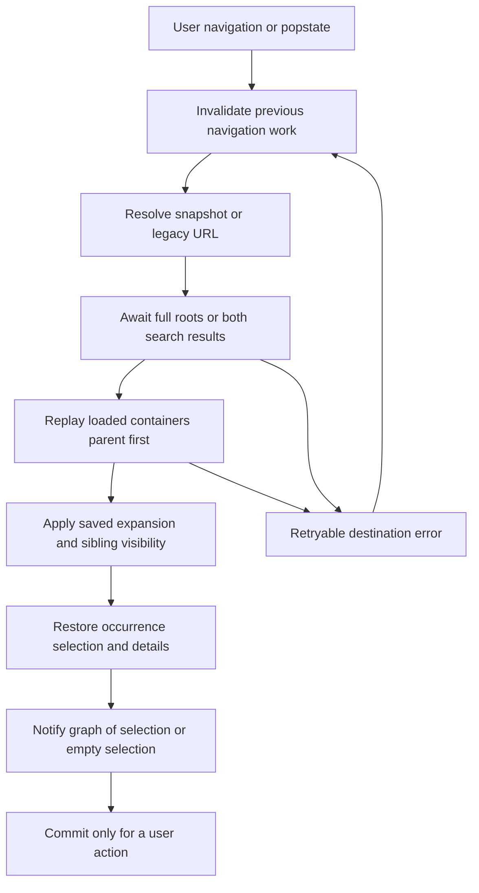
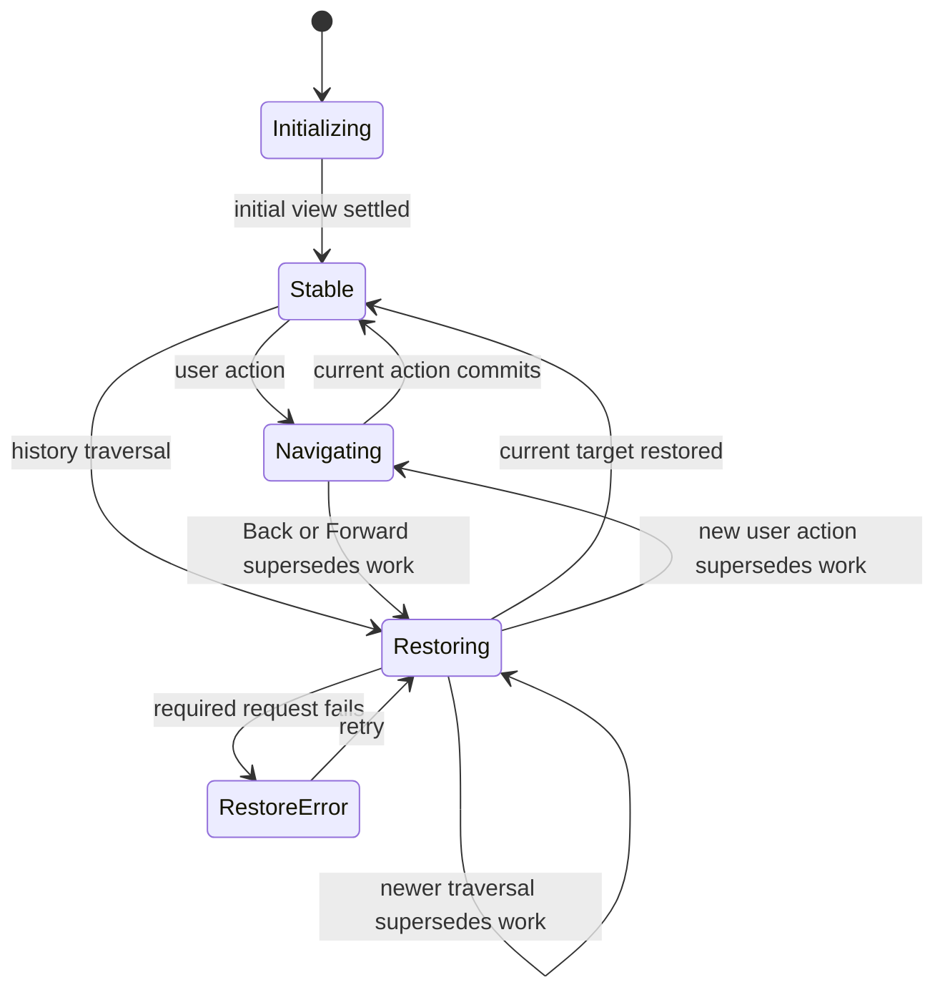

# Explorer Browser History - Plan

## Goal Capsule

- **Objective:** People browsing the FOLIO Explorer can use browser Back and Forward to return to their query, opened branches, and selected concept without rebuilding their place by hand.
- **Means:** Save each committed tree view in browser history and replay it through the existing tree loaders, with ownership checks that prevent older requests from replacing the destination view (KTD1-KTD5).
- **Authority:** The supplied drawdown mandate selects expansion `fa-1`. The chief repo's `docs/plans/2026-10-26-0705-feat-codex-drawdown-campaign-plan.md` governs the campaign; its Goal Capsule and cited campaign R11, R15, R16, R17, R19, and R20 are the required upstream excerpt. The prior navigable-tree plan supplies the existing behavior to preserve.
- **Authority availability:** The chief repo and `ops/drawdown/mandates/_common.md` are absent from this sandbox. Campaign rule mappings below come from the supplied mandate, not an independent reading of that plan. The controller must reconcile this plan against that excerpt before dispatching the build; obtaining it requires no credential or production access.
- **Execution profile:** Standard depth, five dependent implementation units, one branch: `drawdown/fa-1`. This stage delivers a locally committed plan only.
- **Who finishes:** The build lane implements, simplifies, reviews, verifies, and commits. The controller scans, pushes, and opens the PR; the campaign merge gate handles merging under campaign R15/R19. This clone remains without a remote or GitHub login.
- **Stop conditions:** Report any requirement for production access, schema/data changes, release, outside service, or forbidden credentials. An unavailable test runtime is an evidence gap for the controller, never a passing result or permission to weaken tests.

---

## Product Contract

### Summary

Back and Forward restore the Explorer's complete committed tree view for both nouns and verbs. Search, revealed context, branch visibility, selected occurrence, and details return together. Ordinary browsing keeps the existing controls and visual treatment.

### Problem Frame

Navigable search already lets someone drill below a hit and reveal its siblings. History still records only a node identifier and type. Returning to a previous selection can therefore use the wrong search context or rebuild part of a filtered branch from the full tree. The September plan explicitly deferred preserving the query and revealed set.

### Requirements

**Restoring the view**

- R1. Back and Forward restore the committed search query, filter mode, match counts, and highlighted hits belonging to the destination entry.
- R2. Restore expanded/collapsed branches and revealed/hidden sibling context in both filtered and full trees, including collapsed sections and successfully loaded descendants retained behind collapsed ancestors.
- R3. Restore the selected occurrence and its details, including an explicit absence of selection; selecting one occurrence must not select every copy of the same ontology node.
- R4. Apply R1-R3 equally to classes and properties, including navigation from details links and the Entity Graph.

**History and compatibility**

- R5. Each deliberate navigation action adds at most one history entry; expanding, collapsing, revealing, or hiding within that view updates its current entry without adding a Back stop.
- R6. Initial visits, existing `node`/`type` links, null history state, and old node-only state remain usable.
- R7. Restoring an entry never adds a new entry or overwrites the saved destination with a partially reconstructed view.
- R8. During rapid traversal or a new user action, only the latest applicable navigation and selection may update the tree, details, graph, or history.

**Failure and preservation**

- R9. A failed restoration exposes a working retry at the destination while retaining its saved state; missing ontology branches do not leave endless loading or prevent the remaining view from being usable.
- R10. Preserve search matching, the two-character minimum, the existing zero-results return to the full tree, muted context, sibling controls, keyboard behavior, and the search Expand limit. The origin plan's R1-R15 remain regression obligations except for the history extension explicitly authorized here.
- R11. Add automated browser regressions and committed Playwright screenshots under `docs/plans/evidence/`; retain every existing test and its assertions (campaign R15/R16).

### Acceptance Examples

- AE1. **Covers R1-R5.** Search for a fixture term, expand a hit, reveal siblings, select a context child, then select another node. Back restores the first selection with its query, match count, context styling, and branch state; Forward restores the second selection.
- AE2. **Covers R2, R3, R5.** Reveal siblings, expand a revealed child, hide the siblings, and navigate away. Returning keeps them hidden; reopening the siblings reveals the retained subtree without another child request in that restored view.
- AE3. **Covers R1, R5, R10.** Search A, then B, then Clear or Escape. Back visits B and A; Forward reaches the cleared full tree with no selection. A successful zero-result query still returns to the full tree as today, and the previous search remains reachable.
- AE4. **Covers R2-R4.** Render one class under two parents. Expand only one occurrence and select a descendant there. Traversal preserves that occurrence's state independently of its duplicate and of the property tree.
- AE5. **Covers R6, R7.** Open an existing node link, select another entity, and go Back to the original entry. Repeat with no initial node, old state, and invalid state; none traps the browser in new entries.
- AE6. **Covers R8.** Delay a search, reveal, details fallback, or graph response across rapid Back/Forward. Releasing it cannot change the destination's view, selection, error message, or history entry.
- AE7. **Covers R7, R9.** Fail a required restore request, then retry successfully. The destination URL and saved snapshot remain intact throughout, and retry adds no history entry.

### Scope Boundaries

- Scope is the deferred Back/Forward work in the origin plan, on `/explore/tree`. A new follow-up plan preserves the shipped origin document unchanged.
- Production hosts, configuration drift, schema migrations, data rewrites, releases, and new outside services are outside this item. No runtime framework or router is introduced.
- Search text and branch state stay in the history entry. New shareable query URLs, saved searches, cross-tab persistence, and an offline cache are not needed for this outcome; reconsider only for a separately requested sharing or offline feature.
- Graph pan/zoom, expanded graph nodes, full-screen state, tab choice, tree scroll position, and draft search text are not added to the history contract. Only the graph's response to restored or cleared selection is in scope.
- A general retry redesign for full-tree browsing is not included. The awaitable loaders and restore retry address the history path; broader error UX needs separate evidence and scope.
- State limits do not silently truncate branches. A browser refusing a state write gets the explicit degraded-history behavior in KTD5 rather than an arbitrary application cap that narrows R2.

#### Deferred to Follow-Up Work

- `fa-2`: accessible graph controls and minimap.
- `fa-3`: isolated API CI. This plan adds a browser regression command but no workflow or API-test isolation changes.

---

## Planning Contract

### Verified Starting State

Source inspection at `39aeca1` found a clean `drawdown/fa-1` checkout. No `AGENTS.md` or `CLAUDE.md` was present in the repository or its visible ancestor directories; the supplied instructions apply. No application, test, or browser execution occurred in this plan stage, so this is not a passing baseline.

| Existing code | Finding that shapes this plan |
|---|---|
| `folio_api/static/js/unified_tree.js`: `loadDetails`, `setupHistoryNavigation`, `resetUrlParameters` | Pushes only `{nodeId, type}`, replays through `loadAndSelectNode`, and sometimes replaces state with an empty object. History ownership must be centralized. |
| Same file: `lastSearchTrees`, `toggleSiblingsRow`, `toggleNode` | Query/filter state, expanded classes, retained children, and sibling loaded/open flags are separate state. An IRI set alone cannot describe the view. |
| Same file: `searchUnified`, `loadDetails` | Search completion and details HTML/JSON fallback lack latest-intent checks. Search auto-selection bypasses the normal selection event. Zero total matches calls `clearFilterMode`. |
| Same file: `loadTreeNodes`, `loadAndSelectNode`, `loadNodePath` | Several loaders return no completion promise. Path loading polls DOM indicators, and a failure can leave the wait unresolved. |
| Same file: `collapseAllNodes`, `ensureNodeVisible` | Collapse can remove URL selection while keeping the selected DOM row and details. Normal selection reopens ancestors, so it cannot be replayed unchanged. |
| `folio_api/static/js/entity_graph.js`: `_onEntitySelected`, `onTabActivated`, `refreshFor` | Empty selection is ignored; remembered selection can revive the old graph. Fetch/layout completion needs selection ownership when history changes it. |
| `tests/conftest.py`, `pyproject.toml` | Existing pytest fixtures import the app and load the ontology. No browser test harness is present; invoking those fixtures is unnecessary for isolated frontend tests. |

`.planning/PROJECT.md` establishes the existing jQuery, vanilla JavaScript, Jinja2 stack and the `selectNode`/`selectNodeByIri` graph integration points. Keep that design.

### Assumptions

These are implementation defaults chosen for this item, not additional user-settled product requirements.

- A committed view is the last completed search/navigation plus subsequent successful branch changes. Typing without submitting does not replace its query.
- Search submission, a changed selection, and leaving an active search are navigation boundaries. Repeating an action whose resulting view is unchanged adds no entry.
- Restored selection may remain inside a collapsed ancestor or section. Preserving that saved visibility takes precedence over normal selection's automatic reveal.
- Full ontology payloads are reconstructed from existing endpoints. If ontology contents have changed, preserve valid paths and disclose unavailable branches; history does not freeze an ontology version.
- Reload may reuse a valid current history snapshot. Cross-document BFCache behavior and browser-restart persistence are not acceptance claims.

### Key Technical Decisions

- KTD1. **Use one versioned, namespaced snapshot in native `history.state`.** Store plain identifiers and UI intent, preserving unrelated envelope fields. Do not serialize DOM, jQuery objects, HTML, promises, or response payloads. This follows the [WHATWG History interface](https://html.spec.whatwg.org/multipage/nav-history-apis.html#the-history-interface) and supports R1-R7.
- KTD2. **Identify a node by section and its ordered root-to-node path.** Store selected occurrence, expanded occurrences, successfully materialized child containers, sibling loaded/open state, and section visibility. A root container uses an empty path. Keep this representation in `unified_tree.js`; extend the existing section parameterization rather than adding a second controller. Supports R2-R4.
- KTD3. **Centralize capture, write, and restore ownership.** Capture the outgoing committed view before destructive navigation. Initial completed state uses replace; completed user navigation uses push; view-only gestures use coalesced replace. Preserve existing `node`/`type` URL behavior and unrelated parameters/hash. A valid snapshot owns selection during replay, even when Collapse all removed the node URL. Supports R5-R7; see the action table below.
- KTD4. **Make restoration awaitable and owned by a navigation generation.** Replace history-path polling with loaders that settle on success, error, or cancellation. Rebuild roots/results, replay materialized paths parent-first, apply saved visibility, then apply selection without automatic reveal. Guard every fetch completion, fallback, timer, animation callback, graph layout/render, and history write that can outlive its view. Use a separate selection generation where selection changes within one tree. An old completion or `finally` cannot release a newer operation's ownership. Supports R7-R9.
- KTD5. **Keep failures local and preserve the intended destination.** Failed restoration leaves its snapshot untouched and shows a retry for the current destination. A missing node/path is skipped with a visible notice; a missing selected node clears selection/details/graph in the rendered view without rewriting the saved target. Catch history write failures, keep ordinary browsing usable, and show a concise notice that the latest view could not be saved. No automatic back-navigation, hidden truncation, or new storage service. Supports R6-R9.
- KTD6. **Use additive Python Playwright tests with standard-library unittest.** Put them in `tests/browser/` with filenames ending `_browser.py`, invoked directly rather than collected by pytest. Add a test-only `browser` dependency group and update `uv.lock`; do not import the API or `tests/conftest.py`. This adapts the [standalone Playwright library](https://playwright.dev/python/docs/library) to the existing Python repo without a Node toolchain. Supports R11.
- KTD7. **Keep the campaign's delivery choices.** Guarded expansions proceed through the merge gate (session-settled: user-directed — chosen over holding every expansion for owner review: the supplied campaign instruction settles publication). Astra remains the execution model (session-settled: user-directed — chosen over the Sol-first ladder: campaign instruction). No work waits for owner availability through 2026-10-30 (session-settled: user-directed — chosen over waiting for decisions: campaign instruction). Once authorized work is exhausted, durable hygiene is the fallback (session-settled: user-directed — chosen over speculative features: campaign instruction); this item does not activate that fallback.

Native history fits the existing integration points and needs no persisted server schema. A new router or local-storage session model would add ownership and invalidation work without improving this bounded outcome; no unresolved architectural alternative requires a prototype.

### History Action Contract

This table defines KTD3's commit boundaries. Nested helper calls never make their own navigation entries.

| Trigger | History operation | Result |
|---|---|---|
| First load with no supported snapshot | Replace after URL-derived initialization | Initial full tree or legacy node view becomes returnable. |
| Reload/current entry with supported snapshot | Restore; no ordinary write | Saved query and branch state are not overwritten by eager root initialization. |
| Successful submitted search with matches | One push after rendering and first-match selection | Query, both trees, selection, details intent, and node/type URL are one view. |
| Successful submitted search with zero matches | One push only if resulting view changed | Preserve the existing return to full roots, with empty query and selection; remove stale node/type parameters. |
| Failed search request or invalid input | No successful destination push | Keep the preceding committed view and show the failure; do not disguise HTTP/JSON failure as zero matches. |
| Changed user selection, including details/graph links | One push | Outgoing snapshot is retained before automatic reveal; destination includes the final selected occurrence. |
| Branch/sibling/section controls | Replace after successful gesture | Keep loaded-but-hidden descendants and visibility; batch Expand/Collapse into one update. |
| Clear, Escape, or empty submission leaving search | One push | Full roots, empty selection/details, and removed node/type URL; an already clear view is a no-op. |
| Back, Forward, or restore retry | No ordinary push/replace | Apply the destination under its ownership token and notify selection once. |

### High-Level Technical Design

The snapshot describes child containers that were loaded, independently of which ones are visible. Rebuilding a hidden loaded subtree is necessary for AE2. Deduplicate data requests for equal section/parent identifiers during one restore, but apply results independently to each saved occurrence. Serialize branch reconstruction or use bounded concurrency; do not replay the Expand controls or their request cascades.

New user navigation during restoration starts from the intended current entry, not a capture of its partial DOM. Disable view-only controls until the affected restore settles; allow Back/Forward and a new search to supersede it. Keep the snapshot private to the existing page; no API or MCP interface changes are necessary for browser history behavior.

### Constraints and Risks

- The origin's KTD9 avoided a JavaScript runner for the earlier feature. The current mandate's automated-test requirement warrants KTD6's test-only addition. Its temporary screenshot procedure is superseded by R11's committed evidence.
- `entity:selected` must represent explicit empty selection as well as a node. Invalidate graph pending work and remembered selection on empty state; preserve existing lazy activation and graph rendering otherwise.
- Browsers impose serialization and history-write limits with no portable guaranteed byte ceiling. Store compact path data, coalesce gesture writes, and handle rejection under KTD5 ([pushState constraints](https://developer.mozilla.org/en-US/docs/Web/API/History/pushState)).
- Initial entries need explicit state; push/replace do not emit `popstate`. Navigation completion alone is not proof that asynchronous UI replay finished ([History initialization](https://developer.mozilla.org/en-US/docs/Web/API/History_API/Working_with_the_History_API#using_replacestate), [popstate](https://developer.mozilla.org/en-US/docs/Web/API/Window/popstate_event)).
- The sandbox denies Unix sockets. Browser startup and API fixtures may therefore require the controller's permitted verification environment. Do not work around this by monkeypatching sockets, logging, or application behavior; the historical verification learning is `docs/solutions/developer-experience/2026-09-19-codex-worker-sandbox-cannot-run-pytest-or-app.md`.
- Campaign R11 prohibits reading credentials, `.env*`, `*.pem`, `*.key`, secret directories, or `twin-secrets/`. Campaign R17 requires this item alone on its branch. Campaign R20 routes genuinely owner-only blockers to a decision receipt; none is currently identified.

---

## Implementation Units

### U1. Establish browser characterization and history regressions

- **Goal:** Exercise the real Explorer frontend through native browser history with deterministic data.
- **Requirements:** R10, R11; KTD6.
- **Dependencies:** None.
- **Files:** `tests/browser/tree_history_browser.py` (new), `tests/browser/support.py` (new), `tests/browser/README.md` (new), `pyproject.toml`, `uv.lock`. Read the existing tree/base templates and vendored assets as fixtures; do not copy the implementation into tests.
- **Approach:**
  1. Render `folio_api/templates/jinja2/explore/tree.html` through Jinja2 with minimal explicit test context, without importing `folio_api.api` or reading runtime configuration.
  2. Route the page, local scripts/CSS, and synthetic class/property endpoints through Playwright at a test origin. Use real vendored jQuery and application scripts. Handle expected presentation-only external resources locally and fail unexpected network requests.
  3. Provide class/property hierarchies, a multi-parent node, two search queries, zero-result responses, details fragments, and graph responses. Include delayed and failed responses controlled by events, not sleeps.
  4. Keep screenshot writing opt-in so routine verification does not modify tracked evidence.
- **Execution note:** Characterize current controls first, then add failing native Back/Forward assertions before changing history behavior. Confirm those failures are application assertions rather than browser-launch failures.
- **Patterns to follow:** Current endpoint fields pinned by `tests/routes/test_tree_search.py`; actual templates/scripts loaded by the Explorer.
- **Test scenarios:**
  1. Existing search, expansion, sibling hide/show, keyboard controls, and details navigation operate with both fixture entity types.
  2. Covers AE1. Native Back/Forward exposes the current lost-context behavior and becomes the regression proof for U2-U3.
  3. Unexpected network access fails with a useful request description; missing Playwright/browser prerequisites fail the explicit command rather than silently skip it.
- **Verification:** The new harness loads real frontend assets without API startup. Existing pytest files and their assertions remain unchanged.

### U2. Capture complete views and establish navigation boundaries

- **Goal:** Every completed action leaves history with the correct outgoing and destination views.
- **Requirements:** R1-R6, R10; KTD1-KTD3.
- **Dependencies:** U1.
- **Files:** `folio_api/static/js/unified_tree.js`, `tests/browser/tree_history_browser.py`, `tests/browser/support.py`.
- **Approach:**
  1. Add snapshot capture/validation and typed occurrence lookup beside the existing cache/state helpers.
  2. Route writes from details loading, search completion, selection, clear/reset, and branch controls through KTD3's action contract.
  3. Separate committed query from draft input. Combine search's automatic selection with its one navigation commit and the existing selection event.
  4. Capture successful materialization, including hidden siblings and collapsed descendants. Replace the snapshot when Collapse all changes URL state without discarding retained selection.
- **Patterns to follow:** `SECTIONS`, container-local merge identity, `setupNodeClickHandlers`, and the existing event integration.
- **Test scenarios:**
  1. Search with first selection adds one entry; a repeat that leaves the view unchanged and a same-occurrence selection add none.
  2. Covers AE2 and AE4. Two occurrences of one IRI retain independent expansion, hidden loaded siblings, and selection paths.
  3. Covers AE3. Search A/B, Clear, Escape, empty submission, and zero results obey the action table; invalid one-character input changes no committed state.
  4. Expand/Collapse and sibling/section controls add no Back stops. Preserve unrelated URL parameters, hash, and state fields.
  5. Collapse all retains the existing hidden selection/details while removing the node URL; the saved snapshot still records that selection.
- **Verification:** Assert native traversal destinations and rendered state; inspect history length only as supporting evidence.

### U3. Replay snapshots with asynchronous ownership and retry

- **Goal:** Back/Forward reconstructs the intended view and cannot be overwritten by stale work.
- **Requirements:** R1-R3, R6-R10; KTD1-KTD5.
- **Dependencies:** U2.
- **Files:** `folio_api/static/js/unified_tree.js`, `tests/browser/tree_history_browser.py`, `tests/browser/support.py`.
- **Approach:**
  1. Make the required root, path, search, merge, and details loaders awaitable. Replace the history path's indicator polling with explicit settled results.
  2. Choose saved-state replay or URL-derived initialization before eager root loads. Reconstruct in KTD4's order, resolving occurrences within their parent containers.
  3. Extend the existing generation checks to every reachable asynchronous mutation and nested selection path. Tie snapshot replacement to its original entry and generation.
  4. Add restore-specific failure/retry handling under KTD5; validate unsupported/malformed state before accessing `SECTIONS` or walking paths.
- **Patterns to follow:** `searchGeneration`, `revealGeneration`, and the current filtered-row retry control. Keep one fetch/merge path for normal browsing and replay.
- **Test scenarios:**
  1. Covers AE1-AE5. Traverse both directions repeatedly across searches, full-tree selections, hidden context, deep paths, collapsed sections, and the initial entry; replay creates no entries.
  2. Covers AE6. Hold old search, root, reveal, path, details HTML, and JSON-fallback responses across traversal or a newer selection; release them after the destination settles and assert no changes.
  3. Covers AE7. Fail a required restore fetch, retry successfully, and confirm the original snapshot survives. A deleted selected node and missing nonselected branch show the defined partial-view notice without endless loading.
  4. Reload a populated entry; test null/legacy/unknown-version/malformed state and invalid type using the URL fallback. A new user navigation after Back removes the old Forward branch normally.
  5. Simulate a history-write exception; ordinary browsing remains usable and the degraded-history notice appears. No transient loading/error DOM is captured as successful state.
  6. Restore a large saved view with repeated parent IRIs; requests are deduplicated per restore and bounded in concurrency without omitting any saved branch.
- **Verification:** Native browser traversal plus retrying DOM assertions proves every state component. Delayed-response checks use explicit request barriers and cancellation-aware cleanup.

### U4. Keep graph selection consistent with history

- **Goal:** The Entity Graph represents the destination selection or its empty state.
- **Requirements:** R3, R4, R8; KTD4.
- **Dependencies:** U3.
- **Files:** `folio_api/static/js/unified_tree.js`, `folio_api/static/js/entity_graph.js`, `tests/browser/tree_history_browser.py`, `tests/browser/support.py`.
- **Approach:**
  1. Deliver one effective `entity:selected` notification after restoration, including explicit empty selection.
  2. Clear graph remembered selection on empty state and fence fetch, expansion, layout, and scheduled render completion against an obsolete selection.
  3. Keep lazy activation and existing visual controls; make no graph layout or minimap changes.
- **Patterns to follow:** Existing custom-event coupling and `EntityGraph.onTabActivated`.
- **Test scenarios:**
  1. Restoring class/property selections updates an active graph and produces the correct graph when the tab is activated later.
  2. Clearing or returning to the initial empty entry clears an active graph and prevents later activation from resurrecting the old selection.
  3. Covers AE6. A delayed old graph fetch, child expansion, or layout cannot paint over the current or empty graph; a graph-node click still selects through the tree and makes one entry.
- **Verification:** Observe actual graph content and selection events in the browser, not only mocked listener calls.

### U5. Verify regressions and commit visual evidence

- **Goal:** The controller receives reproducible acceptance evidence for this item.
- **Requirements:** R10, R11; KTD7.
- **Dependencies:** U1-U4.
- **Files:** `tests/browser/README.md`, `docs/plans/evidence/fa-1-tree-history-back.png` (new), `docs/plans/evidence/fa-1-tree-history-forward.png` (new), `docs/plans/evidence/fa-1-tree-history-verification.md` (new).
- **Approach:** Run the verification contract, inspect both restored screenshots in the existing page style, and record exact results and environment limits. Use only synthetic/public ontology examples in committed evidence.
- **Test scenarios:** All U1-U4 scenarios are required. Exercise light/dark presentation and both tree sections; verify the existing Enter/Space sibling controls and Arrow navigation still work after replay.
- **Verification:** Passes, failures, skips inherited from the live ontology suite, and environment blockers are stated separately. The receipt identifies screenshots, browser/version, commands, and tested revision; it contains no local machine paths or private data.

---

## Verification Contract

These are build-stage checks, not results from this planning run.

| Check | Invocation or evidence | Acceptance |
|---|---|---|
| Baseline | `uv run pytest` before implementation | Record the actual starting result; distinguish environmental failure from assertion failure. |
| Browser setup | `uv sync --group browser`; `uv run --group browser playwright install chromium` | Reuse dependency/browser caches under the configured cache location. No credentials or new service. |
| Browser regression suite | `uv run --group browser python -m unittest discover -s tests/browser -p '*_browser.py'` | All U1-U4 cases run and pass using real scripts and native Back/Forward. No silently skipped prerequisites. |
| Focused API regressions | `uv run pytest tests/routes/test_tree_search.py tests/routes/test_entity_graph.py tests/test_app_starts.py` | Existing payload and startup contracts pass unchanged. |
| Full regression suite | `uv run pytest` | Existing tests retained; no reduced assertions or altered acceptance thresholds. |
| Playwright evidence | Opt-in screenshot mode documented in `tests/browser/README.md` | Save and inspect both named PNGs after restored-state assertions pass. Commit them under `docs/plans/evidence/`. |
| Real-app smoke | Controller's ordinary local app with actual ontology data | Repeat search/reveal/select/Back/Forward for nouns and verbs; verify details and graph. Fixture results do not claim this integration coverage. |
| Diff review | Item-only implementation, tests, dependency lock change, evidence | No production/config drift, migration, release, service, unrelated cleanup, or machine-local paths. |

Use [Playwright routing](https://playwright.dev/python/docs/network) for deterministic responses and [retrying assertions](https://playwright.dev/python/docs/test-assertions) for completion. Same-document history methods can finish before application replay; neither URL equality nor `networkidle` is the sole oracle. Capture screenshots through [Playwright's screenshot API](https://playwright.dev/python/docs/screenshots).

If the sandbox prevents ordinary browser or API execution, retain the tests and report the exact failure for controller verification. Do not claim completion, generate a substitute image, bypass socket restrictions, or weaken the verification contract. No owner-only decision is needed to run these checks in the controller's authorized environment.

---

## Definition of Done

- R1-R11 are demonstrated by the implementation-unit checks and verification receipt.
- Native Back and Forward recover query, branch occurrence state, selected details, and graph selection for both trees without extra entries or stale-response overwrites.
- Existing tests remain intact and pass; the browser regression suite passes in an ordinary supported runtime.
- Both Playwright screenshots and the public-safe verification receipt are committed. The build response includes `SCREENSHOT: docs/plans/evidence/fa-1-tree-history-back.png` and the Forward screenshot path.
- No abandoned implementation attempts, unused test doubles, or unrelated refactors remain in the diff.
- Work stays on `drawdown/fa-1`; local commits are handed to the controller under campaign R15/R17/R19. No remote, credentials, production changes, or deployment are introduced by this lane.
