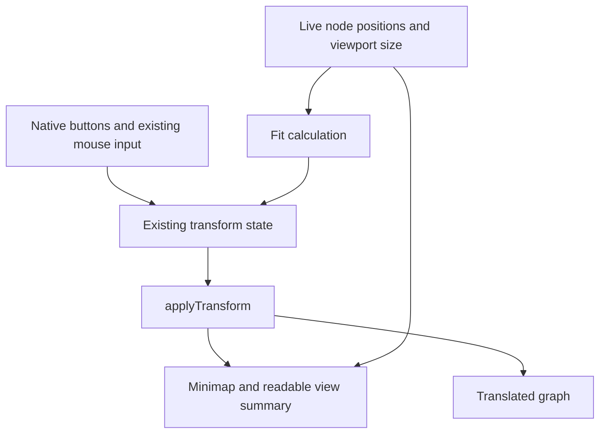
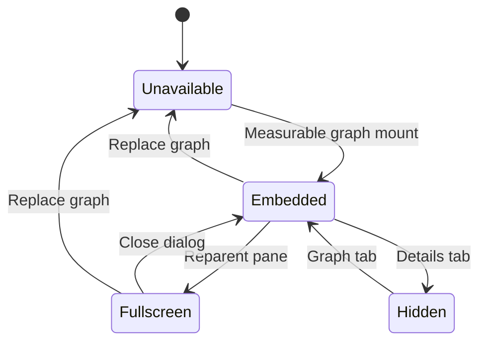
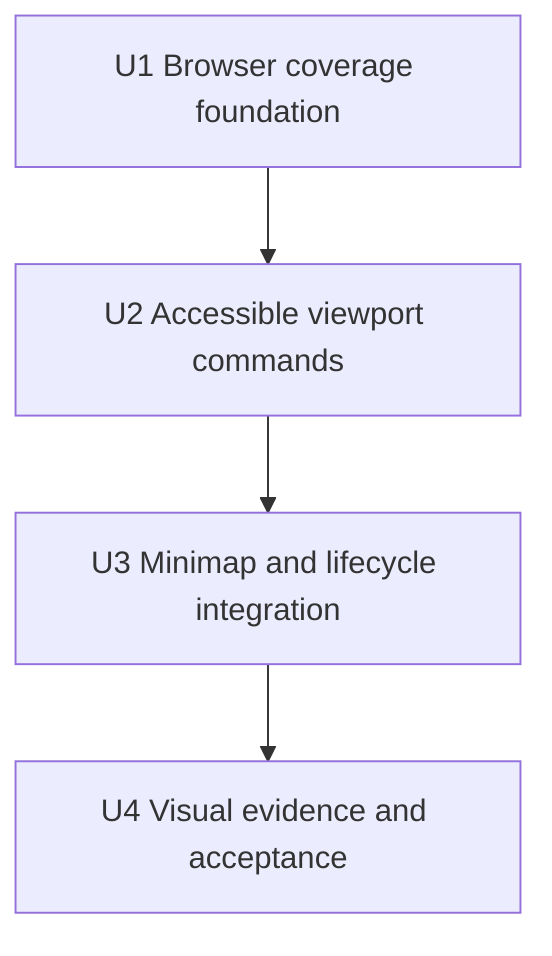

# Accessible Graph Controls and Minimap - Plan

## Goal Capsule

- **Objective:** People browsing FOLIO can navigate the entity graph without dragging or a scroll wheel and can tell where their current view sits within the graph.
- **Means:** Extend the existing graph's shared viewport state, native controls, and passive minimap (KTD1–KTD5).
- **Authority:** The controller's `fa-2` mandate and campaign standing rules govern this item. The chief repository's `docs/plans/2026-10-26-0705-feat-codex-drawdown-campaign-plan.md` is campaign authority; `.planning/PROJECT.md`, `.planning/STATE.md`, and current repository code supply local constraints. Campaign R-IDs are explicitly prefixed below to distinguish them from this plan's R-IDs.
- **Authority limitation:** The chief repository is not mounted in this clone. Its Goal Capsule and original R11, R15, R16, R17, R19, and R20 could not be inspected; the trace below uses the standing rules supplied by the controller. The controller must compare those sections before build dispatch. This requires campaign context, not a login or a decision from the user.
- **Execution profile:** This is a plan-only delivery. The later build uses `lfg` on this plan, implements and verifies only `fa-2`, and commits locally on `drawdown/fa-2`. The clone has no remote or GitHub login; workers must not add either or look for credentials.
- **Who finishes:** The build lane produces code, added tests, and browser evidence. The controller scans, pushes, and opens the PR; the campaign merge gate handles reviews and merge under Campaign R15/R19.
- **Stop conditions:** Apply R7–R8. Missing browser capability leaves acceptance evidence pending for the controller; it is not a passing result or a reason to weaken a test.

---

## Product Contract

### Summary

Add accessible pan, zoom, and fit controls to the existing entity graph. Complete its existing minimap with reliable viewport tracking, readable state, and responsive behavior in the detail pane and full-screen dialog.

### Problem Frame

The graph currently requires a mouse drag to pan and a wheel to zoom. It already contains a passive canvas minimap, although `.planning/STATE.md` still lists the entire controls/minimap feature as deferred. Its viewport rectangle does not follow container-only resizing, and it can disappear from the map when the user pans away from the graph.

FOLIO's stated value is a taxonomy that is browsable, searchable, and visually clear. Making viewport navigation available through ordinary buttons addresses the deferred item without replacing the primary tree or redesigning node selection.

### Requirements

#### View navigation and orientation

- R1. Expose pan in four directions, zoom in, zoom out, and fit through named native buttons operable by pointer, Tab, Enter, and Space.
- R2. Show the loaded graph and current visible area in one minimap, synchronized with navigation, node movement, expansion, and viewport size changes.
- R3. Give the new controls visible focus, usable targets, and readable view information; preserve appropriate focus in both embedded and full-screen use.
- R4. Preserve the existing graph's lazy loading, selection integration, expansion, mouse navigation, and in-memory state across pane/full-screen transitions.
- R5. Keep controls and overview consistent with the mounted graph through empty, loading, error, hidden, and replaced-pane states.

#### Evidence and campaign boundaries

- R6. Add automated tests for the built behavior, retain every existing test, and commit Playwright screenshots of the changed `/explore/tree` page under `docs/plans/evidence/` (Campaign R15/R16).
- R7. Limit the change to `fa-2` on `drawdown/fa-2`, with no production-box work, schema migration, data rewrite, package release, or new outside service (Campaign R16/R17).
- R8. Preserve the campaign's local-only delivery and hard stops: no spend, credential/security-setting changes, sending messages in the user's voice, deletion without a verified backup, force-push, or reading prohibited secret files (Campaign R11/R15/R19/R20).

### Scope Boundaries

The active scope is viewport controls and the existing minimap on `/explore/tree`. It includes the focus, measurement, and lifecycle changes needed to keep these controls usable.

Deferred to other work:

- `fa-1`: browser Back/Forward preservation of search, expanded branches, and selection.
- `fa-3`: isolated API CI using the existing route and startup tests.
- Existing backlog: graph-node keyboard navigation, nonselected-node expansion accessibility, relationship labels, mobile gestures, server caching, and production drift.

Considered and not built:

- A clickable/draggable minimap and global keyboard shortcuts: native pan/zoom/fit controls provide the requested navigation without another interaction model. Reconsider only for a separately requested navigation capability.
- A second graph layout, a frontend framework, or an npm toolchain: current SVG, canvas, jQuery, and vendored ELK already support the item. Reconsider only if implementation demonstrates a concrete limitation.
- A general fetch-race/error-handling rewrite: existing request behavior is outside this item. Guard newly introduced callbacks and disposal paths; report independently reproduced pre-existing defects separately.

### Acceptance Examples

- AE1. **Covers R1/R3/R4.** With a loaded graph, a keyboard user zooms, pans, and fits using native controls; each action changes the view once, keeps focus, and leaves selection and expanded nodes unchanged.
- AE2. **Covers R2/R3.** After panning the graph completely out of view, the overview still represents both the graph and visible area, and readable text identifies that no nodes are visible and points to Fit.
- AE3. **Covers R2/R4/R5.** After zooming and expanding children, the user resizes the detail pane, enters full screen, returns, and switches tabs; the camera and expansions survive while the overview reflects each measurable viewport.
- AE4. **Covers R1/R5.** Opening Graph without selection or receiving a graph-load error leaves the existing empty/error UI usable, with no viewport action operating on an old graph.

---

## Planning Contract

### Verified Starting State

Source inspection used clean branch `drawdown/fa-2` at `39aeca15b700fe6241df01d064d435fa5119f0ad`. No application, tests, browser, or production check ran in this planning stage; historical pass counts are not current evidence. No repository or ancestor `AGENTS.md`/`CLAUDE.md` was present in the exposed workspace.

| Surface | Current evidence | Consequence |
|---|---|---|
| Graph viewport | `folio_api/static/js/entity_graph.js`: `state.transform`, `applyTransform`, `_onWheel`, `fitGraph` | Reuse one camera; pan/zoom/fit buttons are absent. Wheel zoom is 0.2–4.0; fit is 0.2–1.0. |
| Existing overview | `entity_graph.js`: `renderMinimap`, `_mountGraph`; `folio_api/static/css/styles.css`: `.graph-minimap` | A passive 140×90 canvas already exists. Improve it rather than add a second map. |
| Live geometry | `entity_graph.js`: `_nodeDragMove`, `nodePositions`, `liveNodeMap` | Drag changes live positions, while Fit currently reads the original layout. Exposed Fit must use current bounds, including negative coordinates. |
| Lifecycle | `entity_graph.js`: `clearStates`, `renderGraph`, `expand`, `onTabActivated`, `toggleFullscreen` | Mount replaces pane children; expansion preserves zoom; full screen reparents the same pane; returning to the same selection need not remount. |
| Layout | `folio_api/static/js/split_pane.js`; `styles.css`: `.graph-legend`; `entity_graph.js`: viewport construction | Divider changes do not notify the graph. A fixed 28px legend allowance conflicts with wrapping. |
| Assets | `entity_graph.js`: `loadELK`; `folio_api/templates/jinja2/layouts/base.html`; tracked `folio_api/static/js/vendor/` | ELK and jQuery are present locally. The page still uses its existing Tailwind CDN script; no new asset service is needed. |
| Tests | `pyproject.toml`, `tests/conftest.py`, `tests/routes/test_entity_graph.py`, `tests/test_app_starts.py` | Pytest covers API behavior; there is no browser suite. Existing conftest imports the real app at collection time. |

The source trace is: button or existing pointer input changes `state.transform`; `applyTransform` updates the graph and minimap. Expansion replaces graph DOM while preserving camera state. Full screen moves the same pane and applies the same transform without fitting. These are observed code paths, not runtime acceptance results.

### Assumptions

These are reversible implementation defaults inferred from the mandate, not additional user-approved product decisions:

- AS1. The minimap remains a passive overview. Viewport accessibility is the scope; the left tree remains the canonical selection surface.
- AS2. Each pan action moves the view 80 CSS pixels in its named direction; Zoom uses the existing 1.12 factor. Fit centers current bounds with 16px padding within the existing 20%–100% fitted range. Oversized graphs can remain partly outside the viewport at the 20% floor.
- AS3. Buttons use the existing visual vocabulary, preferably 36px targets with a minimum of 24×24 CSS pixels. Controls and legend wrap; the minimap adapts to available width without covering controls or their focus indicators.
- AS4. Readable overview text reports visible/total node counts and zoom, including an explicit offscreen message. It is not a claim that the graph's existing node interactions meet every accessibility criterion.

### Key Technical Decisions

- KTD1. **Keep one camera and renderer.** Implement R1/R4 inside `folio_api/static/js/entity_graph.js`, using its existing `state.transform` and `applyTransform`. Button zoom anchors at the actual viewport center; wheel zoom retains its cursor anchor and 0.2–4.0 clamp. Pan directions describe the viewport moving across the graph, so content moves oppositely. Navigation performs no fetch or ELK layout. A new viewport abstraction is unnecessary for this bounded change.

- KTD2. **Use ordinary button semantics.** For R1/R3, put native, non-submitting buttons in a labelled group outside `#graph-transform`. Keep ordinary Tab order instead of adding an ARIA toolbar's roving-focus model. At zoom limits, use guarded `aria-disabled` controls so focus remains stable; both pointer and keyboard activation must no-op. Keep browser shortcuts, tree/tab arrow handling, and search typing untouched. This choice follows the [WAI button pattern](https://www.w3.org/WAI/ARIA/apg/patterns/button/) and avoids the extra contract in the [toolbar pattern](https://www.w3.org/WAI/ARIA/apg/patterns/toolbar/).

- KTD3. **Derive Fit and overview from rendered geometry.** For R2 and AS2, combine existing graph-space positions with measured, unscaled rendered node dimensions, including the selected node's child-expansion button. The stored layout height is 36px, but that button can make the rendered node taller; stored dimensions alone are insufficient. Refresh measurements after mount and relevant content/size changes without changing ELK layout. Fit, minimap, and visibility counts share these bounds, including negative extents. Frame the minimap using the union of graph bounds and visible graph-space bounds so an offscreen camera remains represented. Both node rectangles and viewport outline use this one projection. Count any node intersecting the visible rectangle as visible; handle empty geometry without non-finite values. Fit uses graph bounds only, subject to AS2.

- KTD4. **Keep the overview passive and readable.** For R2/R3 and AS4, keep the canvas nonfocusable and `aria-hidden` only with the equivalent readable summary outside it. Update readable state with the view; announce the summary politely after discrete button actions, not on each wheel/mousemove frame. Use at least 3:1 contrast for necessary control/map cues, preserve visible focus, and add no motion. Directional buttons provide an alternative to dragging, as illustrated in [W3C dragging guidance](https://www.w3.org/WAI/WCAG22/Understanding/dragging-movements.html); summary timing follows [status-message guidance](https://www.w3.org/WAI/WCAG22/Understanding/status-messages.html).

- KTD5. **Observe the rendered viewport and preserve the camera on resize.** For R4/R5, use normal CSS layout for controls, a usable graph area, and the wrapping legend. Observe the actual untransformed viewport with `ResizeObserver`; resize and pane reparenting keep exact x/y/scale while updating overview dimensions. Disconnect on replacement, cancel pending frame work, and ignore detached/zero-sized hosts. Initial fitting waits for a measurable mount; ordinary resize never refits. Avoid changing observed dimensions inside callbacks. Keep canvas CSS coordinates separate from its device-pixel backing resolution. These decisions follow [ResizeObserver](https://developer.mozilla.org/en-US/docs/Web/API/ResizeObserver) and [devicePixelRatio](https://developer.mozilla.org/en-US/docs/Web/API/Window/devicePixelRatio) guidance.

- KTD6. **Keep one focus lifecycle with the moved pane.** For R3/R5, controls move inside the existing dialog with `#entity-graph-pane`. Preserve Close-on-open, Escape/backdrop dismissal, and return to the Full screen trigger. The trap must use currently visible, focusable elements. When keyboard expansion replaces a focused pane element, restore its logical action/IRI after mount, or the first graph control if it vanished; do not steal focus if the user has moved elsewhere or hidden the graph. This extends the existing reparenting design and the [WAI dialog pattern](https://www.w3.org/WAI/ARIA/apg/patterns/dialog-modal/).

- KTD7. **Add an opt-in Python browser suite.** For R6, add a `browser` dependency group with `pytest-playwright`, locked through `uv.lock`, and put the suite in `browser_tests/` outside `tests/conftest.py` ancestry. Name the explicitly invoked module `browser_tests/entity_graph_controls.py` so default API discovery remains unchanged. Use a supplied local application base URL, the actual `/explore/tree` template and assets, and deterministic API responses where needed. Do not mock ELK, controls, transforms, or minimap rendering. Keep an unintercepted class/property smoke. This uses [Playwright's pytest integration](https://playwright.dev/python/docs/test-runners) without introducing a JavaScript runner or CI work.

- KTD8. **Keep publication with the controller.** Governs R7/R8. Expansions merge through guardrails rather than awaiting personal review (session-settled: user-directed — chosen over holding every expansion for user review: the campaign authorizes guarded expansion delivery). The worker stops after local commits and evidence; the controller owns publication and the campaign merge gate.

- KTD9. **Preserve campaign execution choices.** Governs R8. Local work uses Astra (session-settled: user-directed — chosen over the Sol-first ladder: the campaign fixes local execution). Cloud builds use default Sol and retain Astra/Fable reviews (session-settled: user-directed — chosen over overriding the cloud build model: the campaign specifies that build/review split). No work waits for user time through 2026-10-30 (session-settled: user-directed — chosen over waiting: the campaign assigns no user time). After assigned work, durable hygiene takes precedence (session-settled: user-directed — chosen over speculative features: keep expansion bounded).

### High-Level Technical Design

The existing graph module remains the owner of camera state. Controls and minimap live in the untransformed pane chrome.

The pane keeps the same camera when its host changes; replacement ends the old mount's observers and scheduled work.

Implementation dependencies keep regression coverage ahead of the new behavior.

### Risks and Prerequisites

- **Restricted execution:** Unix sockets are denied in this clone, and prior sandbox runs could not boot the app or run pytest reliably. `docs/solutions/developer-experience/2026-09-19-codex-worker-sandbox-cannot-run-pytest-or-app.md` explains why patched substitutes are not authoritative. Attempt real verification during build; if blocked, retain the checks and route them to the controller's capable environment without changing sandbox/security settings.
- **Real-page evidence:** Browser tests require a working local app and its normal styling. The existing Tailwind CDN must load, or a faithful cached test response must supply that same asset. An unstyled page or synthetic replacement HTML is not screenshot acceptance evidence.
- **Chief source check:** The controller must supply or verify the campaign sections identified in the Goal Capsule. No source access or review result is implied by this plan.
- **Execution-time details:** Exact CSS placement, installed browser availability, and runtime results remain build work. No migration, release, external service, or user-supplied credential is expected.

---

## Implementation Units

### U1. Establish repeatable graph browser coverage

**Goal:** Characterize existing graph behavior and create a runnable home for the new tests.

**Requirements:** R4/R6/R7/R8; KTD7–KTD9.

**Dependencies:** None; recheck branch state before changes.

**Files:** `pyproject.toml`, `uv.lock`, `browser_tests/conftest.py` (new), `browser_tests/entity_graph_controls.py` (new), `browser_tests/fixtures/entity_graph.json` (new), `browser_tests/README.md` (new).

**Approach:**

1. Add the development-only browser group and explicit suite entry point under KTD7, without altering existing API tests or pytest collection rules.
2. Use the real local route and vendored assets. Provide small public/synthetic fixtures for a branched graph, multiple roots, child expansion, and controlled failures; register interception before page actions.
3. Record setup, local base-URL input, and screenshot reproduction in the browser README. Tests must fail clearly when explicitly invoked without a usable app/browser rather than silently skip.

**Execution note:** Establish characterization coverage before changing the renderer; no source-string assertions or mock transform implementations count as behavioral proof.

**Patterns to follow:** Existing `window.EntityGraph` exports and `state`, real `entity:selected` integration, and the API shapes exercised by `tests/routes/test_entity_graph.py`.

**Test scenarios:**

1. Explicit browser collection succeeds without importing `folio_api` or entering the real-app fixture in `tests/conftest.py`.
2. A deep-linked class and a property open Graph with real ELK rendering; a live smoke retains genuine graph responses.
3. Wheel zoom preserves its cursor anchor, drag-pan changes translation, clicking a node selects it, and child expansion preserves zoom.
4. Full-screen entry/exit preserves the same pane and transform; loading, no-selection, and HTTP-error cases retain their existing visible states.

**Verification:** The opt-in suite can be reproduced from its README, and all existing API tests remain present and pass in a capable environment.

### U2. Add accessible viewport commands

**Goal:** Make viewport navigation available through ordinary controls without changing graph data.

**Requirements:** R1/R3/R4/R5/R6; AE1/AE4; AS2/AS3; KTD1/KTD2/KTD6.

**Dependencies:** U1.

**Files:** `folio_api/static/js/entity_graph.js`, `folio_api/static/css/styles.css`, `browser_tests/entity_graph_controls.py`; `folio_api/templates/jinja2/explore/tree.html` only for necessary host/help markup.

**Approach:**

1. Mount the labelled control group outside the transformed content, using the existing icon/style conventions and actual remaining viewport dimensions.
2. Route pan, center-anchored zoom, and Fit through the existing transform path, using KTD3's measured bounds. Keep wheel and background drag semantics intact.
3. Exclude control interactions from background panning and wheel handling; handle focus and unavailable actions under KTD2/KTD6.

**Patterns to follow:** `applyTransform`, `_onWheel`, `fitGraph`, `_panMouseDown`, `_wireFullscreenChrome`, and existing native graph buttons.

**Test scenarios:**

1. Covers AE1. Tab reaches every named control; Enter and Space each activate once and retain focus. No graph request, selection change, expansion loss, or relayout occurs.
2. Four pan buttons move the visible view in their named direction; centered button zoom leaves the graph point under the viewport center unchanged within pixel tolerance.
3. Repeated zoom reaches exactly 20% and 400%; further activation changes nothing, exposes the unavailable state, and retains focus.
4. Fit uses dragged nodes at negative and positive coordinates and includes the selected node's full expansion-button height. A normally sized graph fits with padding; an oversized graph centers at the supported minimum without a false all-visible assertion.
5. Pointer activation on controls does not initiate canvas drag, and wheel over controls does not invoke graph zoom. Existing graph mouse actions still work.
6. Covers AE4. No-selection, loading, and failed-load states cannot invoke stale viewport controls. Search typing, tab arrow keys, and browser shortcuts remain unaffected.

**Verification:** AE1/AE4 and the new command assertions pass against the actual rendered page, including controls used inside the full-screen dialog.

### U3. Complete minimap, resize, and focus synchronization

**Goal:** Keep orientation accurate and controls usable as the graph, viewport, and host change.

**Requirements:** R2/R3/R4/R5/R6; AE2/AE3; AS1/AS4; KTD3–KTD6.

**Dependencies:** U2.

**Files:** `folio_api/static/js/entity_graph.js`, `folio_api/static/css/styles.css`, `browser_tests/entity_graph_controls.py`, `browser_tests/fixtures/entity_graph.json`; `folio_api/templates/jinja2/explore/tree.html` only if the pane needs stable descriptive markup.

**Approach:**

1. Reuse the current canvas, add the view summary, and use KTD3's projection for live geometry and the visible rectangle.
2. Replace fixed chrome-height assumptions with responsive layout and a useful graph area in the stacked page. Implement viewport observation and mount disposal under KTD5.
3. Preserve the moved pane's controls and focus lifecycle. If the existing expansion remount destroys focus, restore it under KTD6 without taking it from another surface.

**Patterns to follow:** `renderMinimap`, `nodePositions`, `_nodeDragMove`, `clearStates`, `renderGraph`, `expand`, `toggleFullscreen`, and the existing modal focus query. Observe viewport sizing rather than adding coupling to `split_pane.js`.

**Test scenarios:**

1. Covers AE2. Fully offscreen panning leaves both graph and view represented on the map; visible-node count reaches zero, the summary names Fit, and Fit recovers the view.
2. Node movement, negative coordinates, multiple roots, and added children update the same map projection and visible/total counts without changing selected IRI. A selected node taller than its layout record remains represented, including when only its expansion-button area intersects the viewport.
3. Covers AE3. Divider-only resize, browser resize, modal entry/exit, and hide-resize-show update the rectangle while preserving exact camera x/y/scale and expansion state.
4. Zero-sized/hidden or replaced mounts produce no non-finite coordinates, stale DOM updates, observer-loop errors, or unbounded fit frames. Repeated remounts do not duplicate active observers or event effects.
5. At device scale factors 1 and 2, canvas backing resolution changes without changing CSS geometry or compounding its drawing transform; missing canvas context does not break graph controls.
6. Full-screen Tab/Shift+Tab includes the new controls and stays within visible dialog actions. Close, Escape, and backdrop dismissal restore the trigger.
7. Keyboard expansion restores logical focus after remount; delayed completion does not take focus back after the user leaves the pane. Entity selection from the tree does not steal focus into graph controls.
8. Readable state updates after navigation, while continuous pointer movement does not produce per-frame live announcements.

**Verification:** AE2/AE3 pass with actual interactions and geometry assertions, with screenshots as additional visual evidence rather than the sole minimap test.

### U4. Verify visual behavior and record acceptance evidence

**Goal:** Leave reproducible, public-safe evidence that the completed controls work and the existing browser experience remains intact.

**Requirements:** R3/R4/R6/R7/R8; AS3; KTD7–KTD9.

**Dependencies:** U3.

**Files:** `browser_tests/entity_graph_controls.py`, `browser_tests/README.md`, `.planning/STATE.md`, `docs/plans/evidence/fa-2-graph-controls-embedded.png` (new), `docs/plans/evidence/fa-2-graph-controls-fullscreen.png` (new), `docs/plans/evidence/fa-2-graph-controls-narrow.png` (new), `docs/plans/evidence/fa-2-verification.md` (new).

**Approach:**

1. Complete desktop, narrow-pane, enlarged-page/text, and reduced-motion checks in the existing design; address defects in the owning U2/U3 files.
2. Capture the actual changed route after a branched/expanded graph and normal styling settle. Include a visible keyboard focus indicator and both embedded/full-screen states.
3. Record exact verification commands, environment constraints, observed results, and screenshot paths. Update only the stale controls/minimap backlog entry when evidence supports completion; retain the other deferred items.

**Test scenarios:**

1. At desktop width and a narrow split pane, every command remains visible and reachable, buttons/legend wrap without covering the graph controls, and the minimap remains legible.
2. At 200% page/text enlargement, focus is visible and not clipped or obscured; the page and dialog remain usable. Reduced-motion preference introduces no new movement.
3. All existing API/startup/cache/rate-limit/search tests pass unchanged alongside the browser suite; required screenshot files show the changed page, not a placeholder or fixture-only replacement page.

**Verification:** Required checks have actual results, new control/map cues meet the stated contrast/target expectations, and committed screenshots match the tested implementation. Any environmental gap remains explicitly pending for the controller.

---

## Verification Contract

All commands below are for the build stage. Planning performed source inspection only.

| Check | Build-stage invocation or evidence | What it establishes |
|---|---|---|
| JavaScript syntax | `node --check folio_api/static/js/entity_graph.js` | Syntax only; not browser behavior. |
| Existing startup smoke | `uv run pytest tests/test_app_starts.py -x` | Real app and ontology fixture startup. |
| Existing regression suite | `uv run pytest tests` | Existing graph/search/routes, cache behavior, and rate limiting stay covered; preserve coverage configuration. |
| Isolated browser collection | `uv run --group browser pytest -o addopts='' --collect-only browser_tests/entity_graph_controls.py` | Browser suite does not load the API suite's conftest. |
| Browser behavior | `uv run --group browser pytest -o addopts='' browser_tests/entity_graph_controls.py --browser chromium --base-url http://127.0.0.1:9616` | U1–U4 behavior against a separately started local app; substitute the controller's local port if needed. |
| Visual proof | Three screenshot paths specified by U4, captured through Playwright | Actual embedded, full-screen, and narrow changed-page appearance. |
| Acceptance receipt | `docs/plans/evidence/fa-2-verification.md` | Exact test results, screenshot provenance, remaining constraints, and any checks still pending. |

The browser group and entry point are planned additions, not existing commands that have already passed. Disabling coverage only for the opt-in browser invocation avoids attributing a separate server's Python coverage to the browser process; the API suite keeps its current coverage behavior. No CI workflow is added here.

Browser assertions must exercise native controls and real rendering. Geometry assertions may inspect the existing exported state and DOM, but must not replace the algorithm under test. Verify rendered minimap bounds or output in addition to transform state. Use the actual local route and at least one unintercepted integration smoke; identify intercepted fixture cases in the receipt.

Screenshots and automated accessibility assertions do not establish whole-page WCAG compliance or a manual screen-reader pass. State precisely what was checked. If socket restrictions prevent tests or screenshots, record the failed command and environmental cause; the controller must run those checks before acceptance. Do not patch socket behavior, weaken assertions, or label the expansion verified without the required image evidence.

---

## Definition of Done

- R1–R5 are demonstrated by the assigned U2/U3 browser scenarios and AE1–AE4.
- U1's repeatable harness and U4's evidence exist; R6 is met with added tests and no deleted, disabled, or weakened existing tests.
- The required screenshot files and verification receipt are committed, and the build-stage final message includes `SCREENSHOT: docs/plans/evidence/fa-2-graph-controls-embedded.png` plus any additional captured paths.
- The source-limited chief-plan check and any environment-blocked runtime checks have been completed by the controller before merge acceptance; no such check is implied by a local commit.
- Changes remain within R7/R8 and one item branch. Abandoned experimental additions are absent from the final diff, and unrelated work is preserved.
- No held change or user decision is expected. If build evidence proves otherwise, finish independent work and report the concrete prerequisite in the campaign's required `Held change` or `Needs your decision` format.

---

## Sources and Research

- `.planning/STATE.md`: deferred controls/minimap item; `.planning/PROJECT.md`: browsing value and stack constraints. The blanket minimap deferral is superseded by current code, not by an assumed test pass.
- `.planning/archive/v1.1/01-entity-graph/deferred-items.md`: scope of deferred node navigation and manual accessibility checks.
- `.planning/archive/v1.1/01-entity-graph/01-13-SUMMARY.md`: full-screen reparenting preserves transform; `.planning/archive/v1.1/01-entity-graph/01-15-SUMMARY.md`: historical accessibility work was primarily static.
- `docs/solutions/developer-experience/2026-09-19-codex-worker-sandbox-cannot-run-pytest-or-app.md`: restricted-worker verification limitations.
- [W3C non-text contrast](https://www.w3.org/WAI/WCAG22/Understanding/non-text-contrast.html), [target size](https://www.w3.org/WAI/WCAG22/Understanding/target-size-minimum.html), and [focus visibility](https://www.w3.org/WAI/WCAG22/Understanding/focus-visible.html): KTD4 and U4 checks for the new UI.
- [Playwright network mocking](https://playwright.dev/python/docs/mock), [locators](https://playwright.dev/python/docs/locators), and [screenshots](https://playwright.dev/python/docs/screenshots): KTD7 and behavioral/visual evidence.
