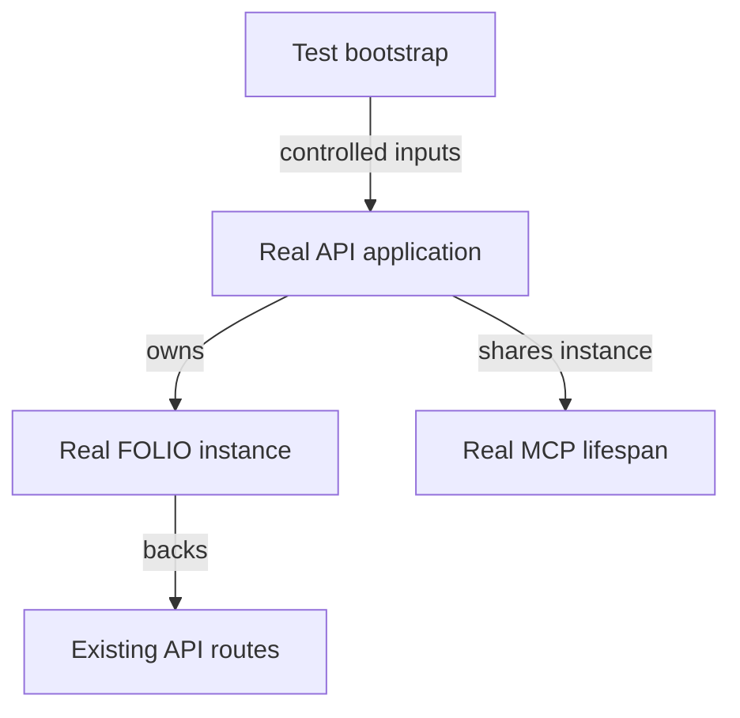
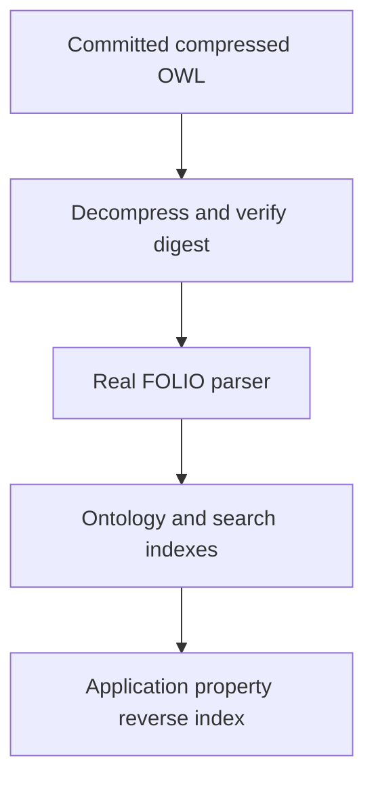
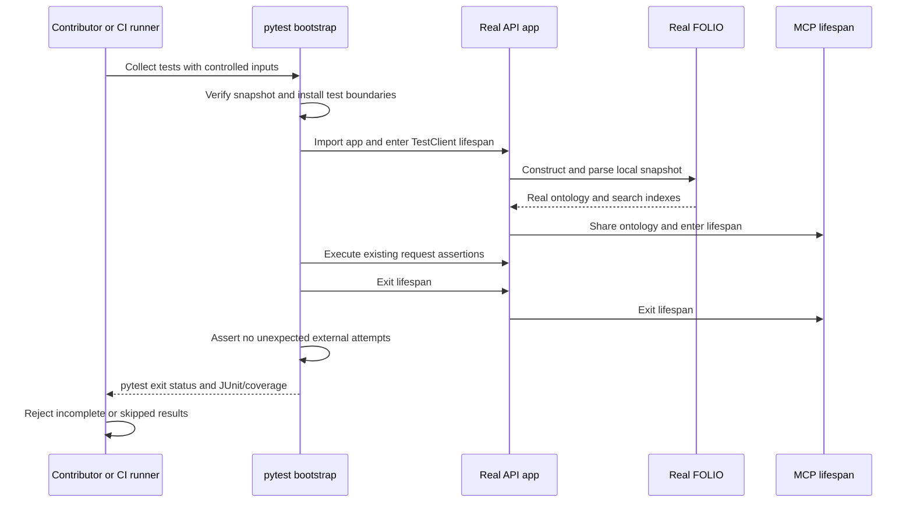
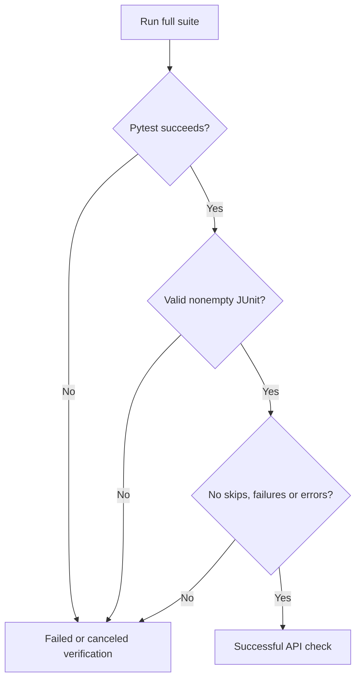

# Isolated API CI (fa-3) - Plan

## Goal Capsule

- **Objective:** Contributors can see whether a proposed folio-api change preserves startup and API behavior before it merges.
- **Means:** Run the existing integration suite against a pinned full ontology in an isolated test environment, then report its result through GitHub Actions (KTD1-KTD6).
- **Authority:** The supplied folio-api mandate, item `fa-3`, and campaign rules R11, R15-R17, R19 and R20 govern this item. The chief repository's authority is `docs/plans/2026-10-26-0705-feat-codex-drawdown-campaign-plan.md`; that file, its Goal Capsule and `ops/drawdown/mandates/_common.md` were unavailable in this sandbox. The supplied mandate is the available authority excerpt, not evidence that the chief files were read. Unqualified R-IDs below refer to this plan; campaign references are labeled explicitly.
- **Execution profile:** This stage delivers only a locally committed plan on `drawdown/fa-3`. A later build stage implements this plan; the controller publishes it and the campaign merge gate handles merging. The clone has no remote or GitHub login by design.
- **Stop conditions:** R5-R6 govern scope and prohibited actions. Report missing runtime evidence honestly; do not replace it with a sandbox workaround.
- **Who finishes:** The build lane supplies implementation, review and local verification evidence. The controller obtains the first real CI result before the merge gate accepts the item.

---

## Product Contract

### Summary

Add isolated API CI around the repository's existing pytest suite. Preserve real FOLIO parsing, route handling and application startup while making test input independent of personal configuration, credentials, warm ontology caches and live ontology downloads.

### Problem Frame

At baseline `39aeca1`, the repository has route and app-start tests but no tracked GitHub Actions workflow. Collection imports the application, which reads local configuration; startup loads ontology data and initializes an optional LLM dependency. Those dependencies make a fresh test run different from a developer's warm environment.

The route tests can skip when required ontology shapes are absent. A green job that skips those assertions would provide misleading evidence to the contributor and merge gate.

### Requirements

**Existing behavior and isolation**

- R1. CI runs the existing app-start and route tests, plus the limiter and static-cache regression tests, without deleting or weakening an existing test.
- R2. Test collection and execution use controlled nonsecret configuration and local ontology input, requiring no personal config, credentials, production access, paid provider call or live ontology fetch.
- R3. The tests retain the real FOLIO parser, indexes, API routes, API/MCP lifespans and property-children construction; add tests for the new isolation behavior.

**Evidence and scope**

- R4. CI reports an actual full-suite result and retains diagnostic reports; failures, skipped assertions and missing runtime verification cannot be reported as a pass.
- R5. Work stays within `fa-3` on `drawdown/fa-3`, with local commits handed to the controller for publication under campaign R15, R17 and R19.
- R6. No production/config-drift work, credential reads or changes, security-setting changes, spend, sends, unbacked deletion, force-push, migration, data rewrite, package release or new outside service belongs to this item (campaign R11 and R15-R16).

### Key Decisions

- **Deliver hygiene within the named item** (session-settled: user-directed — chosen over speculative features: the campaign directs durable hygiene once worthwhile expansions are exhausted). Governs R5-R6.
- **Resolve technical choices without waiting for Damien** (session-settled: user-directed — chosen over waiting for his review: no user time is available through 2026-10-30). Governs R5; any essential user-only blocker follows campaign R20.

### Scope Boundaries

The active changes are test fixtures/bootstrap, CI reporting, the workflow and contributor documentation. Application behavior, dependency versions, deployment files, repository access settings and the production box remain outside scope under R6.

`fa-1` browser history and `fa-2` graph controls/minimap are separate items. No frontend change is planned, so no Playwright screenshot is required for this item.

Considered and not built: a Python-version matrix, scheduled live-ontology job, new network-sandbox package and external coverage service. A single supported runtime and existing pytest stack address this mandate; evidence of a compatibility requirement or an uncovered outbound client would justify revisiting the relevant choice.

---

## Planning Contract

### Reverified Starting State

Static inspection at `39aeca1` found `drawdown/fa-3` with no tracked changes and this plan as its sole untracked file. There is no remote, repository `AGENTS.md`/`CLAUDE.md`, or tracked CI workflow. No application imports or tests ran during planning; historical passes are not a current baseline.

| Surface | Current evidence | Planning consequence |
|---|---|---|
| `tests/test_app_starts.py` | 3 test functions require real startup, classes and a property reverse index | Preserve the lifespan fixture |
| `tests/routes/test_entity_graph.py`, `tests/routes/test_tree_search.py` | 19 test functions; 17 can reach data-dependent skips across 10 skip sites | Keep a full corpus and reject skipped verification |
| `tests/test_rate_limit.py`, `tests/test_static_cache.py` | 24 additional test functions | Run the complete suite, not only the mandate's named subset |
| `tests/conftest.py` | Imports the app before fixtures run | Install isolation before application collection |
| `folio_api/api_config.py`, `folio_api/api.py` | Configuration is read during app construction and lifespan; startup builds the property index and enters MCP lifespan | Use test-only configuration/data seams through shutdown |
| `pyproject.toml`, `uv.lock`, `docker/Dockerfile` | pytest/coverage already present; Docker uses Python 3.12 and honors the lock | Reuse the tooling without dependency upgrades |

The 46 test functions above are a static inventory, not a collected or passing test count.

### Key Technical Decisions

- KTD1. **Commit a complete, compressed public ontology snapshot.** Use `tests/fixtures/folio.owl.gz` with immutable source provenance and a digest of its decompressed bytes. This preserves corpus breadth while removing live fetches; a hand-built miniature graph would narrow the existing real-data coverage. Governs R1-R3. The verified candidate is public FOLIO commit `79f77449c8566d7ac2fc193bed50812cfd2e84cb`: 18,292,334 raw bytes, SHA-256 `b6ed82e6d17b7cb1d468453e4111ec08ca091d72a6849be2b58dd37692cb6ef9`, about 3.7 MB compressed. Compatibility with every test remains a build-stage check. If it fails, diagnose first and select another complete public revision with recorded provenance; do not fabricate data or relax tests. Source: [immutable FOLIO ontology](https://raw.githubusercontent.com/alea-institute/FOLIO/79f77449c8566d7ac2fc193bed50812cfd2e84cb/FOLIO.owl).
- KTD2. **Keep isolation in test infrastructure.** Bootstrap `tests/conftest.py` before application construction, using a small helper in `tests/support.py`. Supply a fresh controlled config with explicit null provider key and stream logging through `api_config.load_config`; do not read or rewrite the repository's runtime config. Replace only FOLIO's raw OWL acquisition boundary with validated fixture text. Keep the real constructor, parser, search indexes, app factory and both lifespans. Retain patches through shutdown and restore them through cleanup even if shutdown raises. Governs R2-R3. Locked folio-python 0.3.6 has GitHub/HTTP sources, no native local-file constructor, and calls `load_owl` before `parse_owl`; these facts were checked against the hash-verified wheel identified by `uv.lock`.
- KTD3. **Disable the dependency's optional LLM fallback explicitly.** Locked FOLIO attempts an OpenAI client even when its caller passes `llm=None`. Disable only that optional branch in the test bootstrap and guard provider construction before credential-file lookup; assert the resulting ontology has no LLM. Record unexpected attempts so a dependency catching an exception cannot hide them. The app still evaluates a provider environment lookup with an explicit null key, but does not use its value. The test guarantee is no provider construction or credential-file access. Governs R2-R3; no production provider behavior changes.
- KTD4. **Guard the current outbound HTTPX boundary.** Reject and record default synchronous/asynchronous HTTPX transport requests during collection, startup, tests and teardown. Preserve TestClient's in-process transport and ordinary socket pairs. Verify the attempt record is empty after the app lifespan; intentional guard tests use their own records. This checks the inspected HTTPX callers, not an OS-wide network firewall. Do not patch sockets, asyncio or global logging handlers. Ordinary runner home-directory logging remains supported. Governs R2-R3; follows `docs/solutions/developer-experience/2026-09-19-codex-worker-sandbox-cannot-run-pytest-or-app.md`.
- KTD5. **Use one Python 3.12 job with locked dependencies.** Install with `uv sync --locked --dev`, then run pytest without another sync. Pin the uv executable version and supported Actions to verified full commit SHAs. A uv download cache may accelerate installation, but no ontology/config/home cache is restored. A cold dependency-cache miss must work. Governs R1-R4. [uv sync semantics](https://docs.astral.sh/uv/concepts/projects/sync/) justify `--locked` for detecting manifest drift; [uv's Actions guide](https://docs.astral.sh/uv/guides/integration/github/) supplies the runner pattern.
- KTD6. **Expose a simple, unmasked check.** Add `.github/workflows/api-tests.yml` with ordinary pull-request events, pushes to `main`, and the `checks_requested` activity of `merge_group`. Use a stable `API tests` job name, workflow/ref-scoped concurrency, a 15-minute job timeout and a shorter test-step timeout. Give checkout read-only contents access and disable persisted checkout credentials. No privileged PR event, secrets, services, deploy step or path filter is needed. Governs R4-R6. [GitHub events](https://docs.github.com/en/actions/reference/workflows-and-actions/events-that-trigger-workflows#merge_group), [workflow syntax](https://docs.github.com/en/actions/reference/workflows-and-actions/workflow-syntax), and [action pinning guidance](https://docs.github.com/en/actions/reference/security/secure-use#using-third-party-actions) support these choices. A campaign merge gate does not establish that GitHub's native merge queue is configured.

  Preserve pytest's exit status independently of `scripts/check_pytest_results.py`, which rejects missing/malformed/empty JUnit results and any reported skips, failures or errors. A valid partial report cannot prove completion or full test selection. The explicit full-suite invocation and successful pytest exit remain required. Pytest 8.4.2 can emit multiple testcase nodes for one test with both call and teardown failures; do not infer a unique-test count by counting nodes. Sources: [pytest JUnit implementation](https://raw.githubusercontent.com/pytest-dev/pytest/8.4.2/src/_pytest/junitxml.py) and [exit-code contract](https://docs.pytest.org/en/8.4.x/reference/exit-codes.html).

  Upload only JUnit and existing coverage XML when available, with seven-day retention. Use a status-aware condition such as `!cancelled()` so prior test failure does not suppress the upload. Reports after cancellation or runner termination are best effort; a canceled run never supplies acceptance evidence. [GitHub status expressions](https://docs.github.com/en/actions/reference/workflows-and-actions/expressions#status-check-functions) explain why a file-existence condition alone is insufficient.

### Assumptions and Execution-Time Checks

- “Isolated” is interpreted as controlled local test inputs with no external API/data calls during tests. Package installation still needs the package registry; no offline installation guarantee is proposed.
- Python 3.12 is the initial CI runtime because it matches `docker/Dockerfile`. This does not claim validation of every version allowed by `requires-python`.
- The controller can use the repository's ordinary Actions runner without a new paid runner or service. Account/billing settings are not inspected or changed by this lane.
- Existing dependency imports can write logs in a normal writable runner home. The current sandbox denies Unix sockets; authoritative TestClient verification may therefore require the controller or Actions. A blocked local run remains missing evidence, never a pass.
- Resolve supported action SHAs and the uv pin during implementation. Do not update `uv.lock` to solve unrelated failures. The controller must reconcile the chief plan's Goal Capsule and cited campaign R-IDs against the supplied excerpt before build; this requires its existing workspace access, not a decision from Damien.

### High-Level Technical Design

The test boundaries in KTD2-KTD4 leave application ownership intact:

The KTD1-KTD2 data path replaces acquisition only:

The startup and shutdown sequence keeps the KTD2-KTD4 boundaries active:

KTD6 determines whether the CI result supplies acceptance evidence:

### Sequencing and Impact

U1 establishes the isolated test input. U2 runs it in CI and enforces report completeness. U3 documents and records the verified execution path. No application-facing interface, deployed data or production configuration changes. The fixture pins test data deliberately; it does not validate future upstream ontology edits automatically.

---

## Implementation Units

### U1. Isolate real app and route verification

**Goal:** Make the existing suite independent of live data, private config and provider initialization while preserving its integration coverage.

**Requirements:** R1-R3, R6. **Dependencies:** None.

**Files:** Modify `tests/conftest.py`; add `tests/support.py`, `tests/fixtures/folio.owl.gz`, `tests/fixtures/README.md` and `tests/test_test_environment.py`. Existing test modules and application files are reference surfaces, not planned rewrites.

**Approach:**

1. Add the KTD1 snapshot and its source/digest/attribution note, using deterministic gzip output. Validate its raw digest before parsing; missing or damaged data has no download/cache fallback.
2. Implement the KTD2-KTD4 bootstrap before app collection. Retain the session-scoped real TestClient lifespan and function-scoped clients from the current conftest.
3. Add fixture and boundary tests before wiring CI. Preserve the full existing suite's assertions and data selectors.

**Patterns:** Current `_booted_app`, `folio` and `property_children` fixtures; dynamic entity selection in both route-test modules; attribution in `THIRD-PARTY.md`.

**Test scenarios:**

1. A clean, credential-free process collects the focused route/app-start selection and the complete suite without opening runtime config or fetching ontology data.
2. The real app serves OpenAPI, real FOLIO contains classes and properties, the reverse index is populated, MCP startup/shutdown completes, and `folio.llm` stays null.
3. The snapshot supports ancestor chains, children, visible/hidden curated roots, a noncurated top-level class, `deontic` class/property matches, a pruned branch, a leaf, shared-word siblings and a property with at least three children. All existing tests execute rather than skip.
4. Missing, truncated or wrong-digest fixture input produces a clear failure before parsing, without a cache or network fallback; corrupt only temporary test copies.
5. Default sync/async HTTPX requests fail before connection, while TestClient requests succeed. An attempted provider construction or caught outbound exception still fails the app-session attempt check.
6. A dummy provider environment variable does not enable an LLM, construct a provider or trigger credential-file access. Focused and repeated fresh-process runs retain the same input contract through teardown.
7. A lifespan-exit error remains a test error; guard accounting and patch cleanup still run after the failing shutdown.

**Verification:** New isolation tests and all existing tests pass on a runner with ordinary sockets. No existing test is removed, weakened, deselected or newly skipped.

### U2. Run and report the isolated suite in CI

**Goal:** Give contributors a reliable API test result for each proposed or merged change.

**Requirements:** R1, R4-R6. **Dependencies:** U1.

**Files:** Add `.github/workflows/api-tests.yml`, `scripts/check_pytest_results.py` and `tests/test_ci_results.py`; use existing `pyproject.toml` and `uv.lock` unchanged.

**Approach:**

1. Apply KTD5-KTD6 to a single hosted-runner job, with explicit installation, full-suite execution, result checking and report-upload stages.
2. Keep the result checker a small standard-library XML reader shared by the documented local path and CI. Do not build a general CI framework or introduce a report service.
3. Capture real collection/pass/skip/failure counts. The static count of 46 functions is a review baseline, not a permanent exact-count assertion.

**Patterns:** Existing pytest coverage options in `pyproject.toml`; lockfile discipline in `docker/Dockerfile`.

**Test scenarios:**

1. A successful nonempty pytest JUnit report passes the checker; a skipped testcase, expected failure, setup/teardown error, failed assertion, absent file, malformed XML or empty report fails.
2. The checker handles pytest's suite container structure without double-counting aggregate totals, including separate call-failure and teardown-error nodes for one test.
3. A cold Python 3.12 job installs the lock and runs all existing and newly added tests; optional cache hits do not alter input selection.
4. A stale lock fails installation. Failed, interrupted, timed-out or canceled pytest execution cannot become successful verification because a partial report or upload succeeds.
5. Workflow inspection verifies the KTD6 events, stable check name, permissions, timeouts and status-aware report conditions. Available reports are retained after ordinary test failure without uploading configuration, logs or home directories.

**Verification:** Workflow validation passes; the real `API tests` job passes after controller publication, with valid reports and zero skips. Do not change branch protections to force that outcome.

### U3. Document reproducible verification and close the evidence gap

**Goal:** Let the next contributor reproduce CI and identify exactly what has been verified.

**Requirements:** R4-R6. **Dependencies:** U1-U2.

**Files:** Modify `README.md` and complete `tests/fixtures/README.md`; add a concise build-stage receipt under `docs/plans/evidence/` when actual execution evidence exists.

**Approach:** Document locked setup, full-suite execution and report checking as one CI-equivalent path. Explain the fixture source/refresh procedure, the HTTPX guard's scope, ordinary filesystem/socket requirements and the boundary between dependency installation and offline test execution. Link the fixture's attribution to `THIRD-PARTY.md`.

**Test expectation:** No separate tests for prose. Reproduce the documented commands on the supported runner and compare them with the workflow.

**Verification:** Record the tested commit, environment, commands, actual counts and CI run URL when available. If the sandbox blocks runtime tests, identify the unrun checks and leave their acceptance pending for the controller.

---

## Verification Contract

These are build-stage checks; none was executed during planning.

| Check | Entry point | Required evidence |
|---|---|---|
| Lock consistency | `uv sync --locked --dev` | Fresh Python 3.12 install succeeds without manifest/lock changes |
| Focused startup/routes | `uv run --no-sync pytest tests/test_app_starts.py tests/routes -ra` | Real startup and route assertions pass; zero skips |
| Full regression suite | `uv run --no-sync pytest tests -ra --junitxml=test-results/pytest.xml` | Every existing test plus new isolation/report tests runs; coverage flags remain active |
| Complete result | `uv run --no-sync python scripts/check_pytest_results.py test-results/pytest.xml` | Nonempty valid report, no skips/failures/errors; pytest exit status remains authoritative |
| Workflow correctness | YAML/Actions validation plus targeted review | KTD5-KTD6 satisfied; no credential, deployment or production dependency |
| Authoritative CI | Controller-published branch's `API tests` check | Real successful run on the reviewed commit, available JUnit and coverage XML |

The main risk is a false green from skipped tests or swallowed external-call failures; U1-U2 provide explicit checks for both. No runtime result is inferred from static inspection, a warm historical cache or a modified event loop.

---

## Definition of Done

- U1-U3 satisfy their verification outcomes and every R-ID is covered.
- All preexisting tests retain their assertions and execute in CI; no exclusions, extra skips or xfails replace coverage.
- The review confirms no production, frontend, dependency-upgrade or unrelated mandate-item changes.
- The build receipt distinguishes local evidence from the controller's CI evidence; a socket-denied run is recorded as blocked verification.
- No abandoned experimental implementation or generated runtime files remain in the proposed diff; preserve unrelated work and backed-up data.
- The build lane leaves focused local commits on `drawdown/fa-3`; publication and merge follow R5. No schema migration, data rewrite, package release or new service is required.
