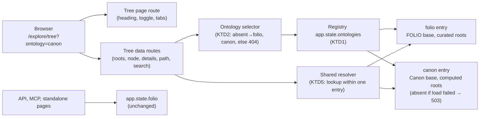

# Canon Tree Toggle - Plan

## Goal Capsule

- **Objective:** Anyone visiting FOLIO's tree explorer can switch to the Catholic Semantic Canon and browse its classes and properties the same way they browse FOLIO, with FOLIO still the default.
- **Means:** A plain FOLIO/Canon toggle on the existing tree page at `folio.openlegalstandard.org/explore/tree` (reached from `/taxonomy/tree`), backed by a second ontology loaded alongside FOLIO (KTD1, KTD2).
- **Product authority:** Damien Riehl. Framing decided 2026-11-06 (Cockpit ask `folio-api-2026-11-06-1326-canon-tree-framing`, qid `canon-framing`). The Product Contract wins on behavior; KTDs win on mechanism.
- **Execution profile:** One pull request with U1 through U5, then a PROD deploy under the standing deploy authorization.
- **Stop conditions:** Stop and report if the FOLIO view, API, or MCP responses change (R10); if PROD memory after deploy leaves less than 20% of host RAM free (host total recorded with the pre-deploy memory sample); or if the Canon needs a change to folio-python's own source or a vendored copy. The test-only isolation patch in KTD9 stays allowed.
- **Who finishes:** `ce-work` builds and verifies; the orchestrator runs the tests, browser UAT, merge, and PROD deploy on the host.
- **Open blockers:** None.

---

## Product Contract

Product Contract preservation: changed: added R15 and AE9 — background Canon loading, directed by Damien on 2026-11-06. Earlier: added R11-R14 — the Canon-unavailable state, FOLIO wording removal, hidden licensing/deprecated roots, and toggle navigation, confirmed at the planning scope check on 2026-11-06. Added AE6-AE8. Outstanding Questions resolved into KTD3, KTD4, and KTD5. Restructured, no scope change: Problem Frame branch count corrected to nine; AE3 and the tree-page Key Decision clarified to match the Canon's data and the tree data routes.

### Summary

The FOLIO tree page gains a plain "FOLIO / Canon" toggle. Switching to Canon reloads the same explorer (class tree, property tree, detail panel, search) from the Catholic Semantic Canon's own ontology. The choice lives in the URL, so shared links open the right view.

### Problem Frame

CatholicOS maintains the Catholic Semantic Canon, a fork of FOLIO with about 15,000 classes under nine top-level branches (Actor, Authority, Document / Artifact, Event, Normative Concepts, Operational Concepts, Place, and licensing and deprecated branches). Its source of truth sits in a login-gated WebProtégé project, and its public form is a set of OWL, TTL, and other exports in `CatholicOS/ontology-semantic-canon`. No one can browse it without ontology tooling.

FOLIO's tree explorer already serves a near-identical ontology well. The Canon needs a public home for browsing now, before it has its own site.

### Key Decisions

- **A plain toggle with no explanatory note or Canon branding.** (session-settled: user-directed — chosen over a "Preview" label crediting CatholicOS and over full Canon branding: Damien picked the plain toggle.) Governs R1, R2, R12.
- **Show "Canon" as the page heading while the Canon view is active.** The Canon's own ontology title still reads "FOLIO", so the toggle and heading are the only cues that the visitor has left FOLIO. (session-settled: user-approved — proposed alongside the plain toggle, with the risk that visitors may not notice the switch; Damien approved the scope.) Governs R3.
- **Only the tree page and its data routes change.** FOLIO's standalone pages, REST API, and entity graph stay FOLIO-only, so removing the Canon later means removing the toggle, the Canon registry entry, and the routes' ontology parameter. Governs R9, R10.
- **The Canon comes from CatholicOS's GitHub repository and follows its latest version.** The repository's README designates WebProtégé exports to it as the published form. (session-settled: user-approved — proposed over a frozen copy at the planning scope check; Damien confirmed.) Governs R7.
- **A Canon outage never takes FOLIO down.** (session-settled: user-approved — confirmed at the planning scope check.) Governs R11.
- **The Canon loads in the background, after FOLIO, so it never slows FOLIO.** (session-settled: user-directed — chosen over loading both ontologies during startup: Damien asked that the Canon load after FOLIO, in stages if that helps FOLIO's performance.) Governs R15.

### Requirements

**Toggle and identity**

- R1. The tree page shows a plain two-way toggle labeled "FOLIO" and "Canon". FOLIO is selected by default.
- R2. The page adds no explanatory note, credit line, or Canon-specific colors or logo in either view.
- R3. While the Canon view is active, the page heading reads "Canon" in place of the FOLIO heading.
- R4. The selected view is part of the page URL. Opening a link with the Canon selected opens the Canon view, including any selected node.
- R12. The Canon view shows no FOLIO wording: the FOLIO website and "Learn More" buttons are absent, and the browser-tab title and search hint name no ontology.
- R14. Switching views opens the other ontology at its top level, with no node selected and no search carried over.

**Canon explorer behavior**

- R5. In the Canon view, the class tree, property tree, detail panel, and search all show Canon data only, with Canon's own top-level branches as roots.
- R13. The Canon's "ZZZ - Licensing" and "ZZZZ - Deprecated" branches stay hidden from the top level, matching how FOLIO hides its equivalents.
- R6. Every in-panel navigation in the Canon view (parents, children, related classes and properties) stays inside the Canon tree. No link in the Canon view opens a FOLIO page or a broken link.
- R7. Canon data comes from the CatholicOS `ontology-semantic-canon` GitHub repository and refreshes on the same schedule and mechanism as FOLIO's data.
- R8. Canon classes and properties keep their own identifiers (`https://ontology.catholicos.catholic/...`). None are rewritten to FOLIO identifiers.
- R11. When the Canon could not be loaded, the toggle is absent, FOLIO works normally, and a Canon link shows a "Canon unavailable" state instead of FOLIO data.

- R15. FOLIO starts and serves without waiting for the Canon. The Canon loads only after FOLIO is serving, and while it loads the toggle is absent and a Canon link shows a "Canon loading" state.

**Boundaries with FOLIO features**

- R9. The detail panel's Entity Graph tab is hidden in the Canon view.
- R10. The FOLIO view, FOLIO's API, and FOLIO's standalone pages behave exactly as before.

### Key Flows

- F1. Switch to the Canon and share a link
  - **Trigger:** A visitor on the FOLIO tree selects "Canon".
  - **Steps:** The page opens the Canon tree at its top level with the heading "Canon"; the visitor searches, opens a class, and follows its parents and children in the detail panel; they copy the URL and send it.
  - **Outcome:** The recipient opens the same Canon view and node.
  - **Covered by:** R1, R3, R4, R5, R6, R14

### Acceptance Examples

- AE1. **Covers R1, R4.** Given a visitor opens `/taxonomy/tree` with no view in the URL, the FOLIO view loads with "FOLIO" selected.
- AE2. **Covers R4, R5.** Given a link with the Canon view and a Canon class selected, opening it shows that class in the Canon tree, not a FOLIO class or an empty panel.
- AE3. **Covers R6, R8.** Given a Canon class detail panel, every parent, child, and related link resolves to a node in the Canon; Canon classes carry `ontology.catholicos.catholic` identifiers, and no link uses a FOLIO identifier.
- AE4. **Covers R9, R10.** Given a visitor switches back to FOLIO, the Entity Graph tab reappears and the FOLIO view matches today's behavior.
- AE5. **Covers R5.** Given a search for "Sacrament" in the Canon view, results come from the Canon, not from FOLIO.
- AE6. **Covers R4, R5.** Given a Canon-view link whose node is a FOLIO-only IRI, the panel shows the explorer's existing not-found state; it never shows a FOLIO class.
- AE7. **Covers R6.** Given a Canon detail panel that names a related item absent from the Canon (for example a W3C or Dublin Core property), the item renders as plain text, not a link.
- AE9. **Covers R15.** Given the app has just started and the Canon is still loading, FOLIO pages and API calls answer normally, `/explore/tree` shows no toggle, and `/explore/tree?ontology=canon` shows "Canon loading"; once loading finishes, the toggle appears on the next page load.
- AE8. **Covers R11.** Given the Canon failed to load at startup, `/explore/tree` shows FOLIO with no toggle, and `/explore/tree?ontology=canon` shows "Canon unavailable" in the tree area.

### Scope Boundaries

- **Deferred for later:** Canon versions of FOLIO's standalone class pages, the REST API, the MCP server, the entity graph, and LLM-backed search.
- **Deferred for later:** A language selector for labels. The tree has none today, and the Canon carries the same multilingual labels FOLIO does.
- **Outside this work:** Editing the Canon. WebProtégé stays its source of truth.
- **Outside this work:** A permanent Canon site. This toggle lives on FOLIO's site only until the Canon has its own home.

### Dependencies / Assumptions

- CatholicOS maintainers export Canon edits from WebProtégé to the GitHub repository. Changes made only in WebProtégé never reach the site.
- "Temporary" carries no end date. Removal means deleting the toggle and its data source, with no data migration.
- The PROD host has memory headroom for a second ontology. Research measured about +135 MB resident memory; the deploy measures it on PROD.

### Sources / Research

- `folio_api/routes/taxonomy.py`: `/taxonomy/tree` returns a 301 to `/explore/tree` and passes through only `node`; FOLIO's class roots come from the hardcoded `ROOT_CLASS_IRI_IDS`.
- `folio_api/routes/properties.py`: property roots are computed, and only hidden roots are hardcoded as FOLIO identifiers.
- `folio_api/routes/explore.py`: the unified tree page; `_FOLIO_IRI_PREFIX` hardcodes FOLIO's identifier prefix, which also appears in other routes.
- `folio_api/api.py`: the app loads one ontology into `app.state.folio`, which the MCP server shares.
- `folio_api/templates/jinja2/components/class_details.html` and `property_details.html`: these detail panels link out to standalone `<iri>/html` pages (relevant to R6).
- folio-python 0.3.6, `folio/graph.py`: the constructor accepts an `http` source URL. Its GitHub loader always fetches `FOLIO.owl`, and `normalize_iri` assumes FOLIO's prefix.
- `CatholicOS/ontology-semantic-canon`, `sources/`: the Canon exports (`.owl`, `.ttl`, `.owx`, `.omn`, `.ofn`), Apache-2.0.

---

## Planning Contract

### Key Technical Decisions

- KTD1. **An ontology registry beside, not instead of, `app.state.folio`.** Startup builds `app.state.ontologies` keyed `folio` and `canon`. Each entry holds its FOLIO-library instance, IRI base, root class IDs, hidden property IRIs, and its own property-children index. `app.state.folio`, `app.state.property_children`, and the MCP's shared instance stay exactly as they are, so every FOLIO-only surface is untouched (R10). Rationale: the tree routes need two ontologies; nothing else does.
- KTD2. **One query parameter selects the ontology everywhere.** The page and every tree data endpoint take `ontology`, case-insensitive. An absent, empty, or `folio` value means FOLIO. `canon` means Canon. Any other value returns 404, because silently serving FOLIO is this feature's worst failure. A Canon request while the Canon is loading or failed returns 503 from data endpoints, with `Retry-After` while loading (R11, R15). The 404 for an unrecognized value is the one deliberate change to FOLIO-facing tree responses; requests without the parameter behave as before (R10). The `/taxonomy/tree` and `/properties/tree` redirects pass the parameter through, with the query built by proper URL encoding (R4).
- KTD3. **Canon loads over the library's `http` source from the raw GitHub URL of the repository's `main` branch.** Probe: `FOLIO(source_type="http", http_url=<raw .owl>, use_cache=True)` parses the Canon with IRIs intact (14,973 classes, 166 properties, 1.3 s cold). The library caches by URL and never revalidates, so the Canon refreshes when the container is recreated or redeployed, exactly like FOLIO (R7). The source URL is an in-code constant. An optional `canon` block in `config.json` carries only an `enabled` flag, and its absence means enabled, so PROD's host-local `config.json` needs no edit.
- KTD4. **Canon loads in a background stage cascade after FOLIO is serving.** Startup finishes with FOLIO alone, so the health check and first requests never wait on the Canon (R15). A background task then runs the Canon in stages: wait for startup to complete, download, parse, then build roots and the property-children index, and only then publish the `canon` registry entry in one assignment, so a request never sees a half-built entry. The heavy stages run in a worker thread that lowers its own scheduling priority (Linux per-thread nice), so FOLIO request handling keeps the CPU; parsing still shares the interpreter lock, which is why the stages are short and sequential rather than parallel. The registry tracks the Canon's state as loading, ready, or failed. Any stage failure logs one warning, sets failed, and FOLIO serves normally (R11). This passes the plan's harm test: a GitHub outage or slow parse would otherwise delay or take down PROD FOLIO, and nothing would catch it in time.
- KTD5. **One shared resolver replaces the five duplicated IRI resolvers on tree routes.** It takes a registry entry and a full IRI or bare ID, and looks up only within that entry. Bare IDs get the entry's own IRI base, never FOLIO's. The O(n) suffix-scan fallback scans only that entry's instance. Evidence: the ontologies share 14,407 bare IDs, and folio-python's `normalize_iri` prepends FOLIO's base to any bare ID, so a FOLIO-prefixed lookup would return the wrong ontology's class (R5, R8). FOLIO lookups keep their current order and results (R10).
- KTD6. **Canon roots are computed, not curated.** Canon roots are classes whose parent list is empty or holds only `owl:Thing`, excluding `owl:Thing` itself and any root whose label starts with "ZZZ" (R13). The Canon declares three branches as subclasses of `owl:Thing` and leaves four (Place, Authority, Normative Concepts, Operational Concepts) with no parent, so an `owl:Thing`-children rule alone finds three of seven. This mirrors `_is_root_property` in `folio_api/routes/properties.py`. Canon has no hidden root properties. FOLIO keeps `ROOT_CLASS_IRI_IDS` and `HIDDEN_ROOT_PROPERTY_IRIS`. Rationale: the Canon follows its latest version (KTD3), so a curated ID list would drift.
- KTD7. **The server renders the view; the toggle is a full page navigation.** `/explore/tree` reads `ontology`, then renders the heading, title, toggle state, branding, and Graph-tab presence server-side (R2, R3, R9, R12), so nothing flashes FOLIO first. The toggle is a pair of links to `/explore/tree` and `/explore/tree?ontology=canon`. Navigation resets the client's node cache, search state, and selection, which share keys across ontologies (R14). The client script receives the ontology once from the page and appends it to every fetch through one helper. URL writes keep the parameter on pushState and popstate (R4).
- KTD8. **Detail panels link by existence, not by prefix.** In the Canon view, the class and property detail templates render a related IRI as an in-tree selection when the Canon contains it, and as plain text otherwise (R6, AE7). The FOLIO view keeps its existing `/html` links unchanged (R10).
- KTD9. **Tests use a pinned Canon fixture.** A gzip of the Canon OWL at commit `935bc5ac8acbe005ab1ba7cd8dfe920d81302890` (about 2.8 MB) sits beside the FOLIO fixture with a SHA-256 check. The isolation patch on `FOLIO.load_owl` returns the Canon snapshot when the requested URL is the Canon's and FOLIO's otherwise, so CI stays offline. The Canon's Apache-2.0 license is recorded in `THIRD-PARTY.md`.

### High-Level Technical Design

### Assumptions

- The PROD container has room for about +135 MB resident memory and about 1 s more startup. No RAM figure is documented; the deploy measures it.
- The Canon keeps using one IRI base and a FOLIO-compatible OWL structure. A structural change upstream would surface as a startup warning (KTD4), not a FOLIO outage.

### Risks

| Risk | Mitigation |
|---|---|
| A tree request reaches the wrong ontology and silently returns a same-ID FOLIO class | KTD5's single resolver, plus tests asserting every Canon response IRI resolves within the Canon and none uses the FOLIO base |
| Upstream Canon changes break parsing after a redeploy | KTD4 isolates the failure; FOLIO stays up and the toggle disappears |
| Startup exceeds health-check windows | Canon parse measured at 1.3 s cold; verify against the PROD compose health check during deploy |
| A template still emits a FOLIO `/html` link in the Canon view | U4 test renders every Canon detail panel variant and asserts no `/html` hrefs |

---

## Implementation Units

### U1. Pinned Canon test fixture and offline load dispatch

**Goal:** Tests can load the Canon offline from a verified snapshot.

**Requirements:** R7, R8 (test support for both).

**Dependencies:** None.

**Files:**
- `tests/fixtures/canon.owl.gz` (new)
- `tests/fixtures/README.md`
- `tests/support.py`
- `tests/test_test_environment.py`
- `THIRD-PARTY.md`

**Approach:**
1. Add the Canon snapshot at the KTD9 commit, compressed the same way as the FOLIO fixture, with its digest and byte count recorded.
2. Make the patched `load_owl` choose the snapshot by requested URL: the Canon URL gets the Canon snapshot, everything else keeps FOLIO's (KTD9).
3. Document provenance and refresh steps beside FOLIO's, and record the Apache-2.0 attribution.

**Patterns to follow:** The FOLIO fixture, `load_snapshot`, and their checks in `tests/support.py` and `tests/test_test_environment.py`.

**Test scenarios:**
- A damaged or truncated Canon snapshot raises the same clear error as a damaged FOLIO snapshot.
- A Canon snapshot with the wrong digest is rejected.
- A load request for the Canon URL returns Canon OWL; a FOLIO request still returns FOLIO OWL.

**Verification:** The full suite passes offline with zero external attempts recorded.

### U2. Ontology registry and isolated Canon loading

**Goal:** The app starts with FOLIO and, when available, the Canon, each reachable through the registry.

**Requirements:** R7, R8, R11, R13, R15; KTD1, KTD3, KTD4, KTD6.

**Dependencies:** U1.

**Files:**
- `folio_api/api.py`
- `folio_api/ontologies.py` (new: registry entry, selector, shared resolver home)
- `config.json.example`
- `tests/support.py` (test config gains the default Canon source)
- `tests/test_app_starts.py`
- `tests/test_ontologies.py` (new)

**Approach:**
1. After FOLIO loads, build the registry with the `folio` entry wrapping the existing instance and indexes, and the Canon state set to loading; startup then completes without waiting.
2. Start the KTD4 background cascade: download and parse per KTD3, compute Canon roots per KTD6, build the Canon property-children index the same way FOLIO's is built, then publish the entry and set ready.
3. Cancel the background task cleanly on shutdown.
4. Read the optional `canon.enabled` flag, defaulting to enabled when absent (KTD3).
5. Give tests a way to wait for the Canon to reach ready or failed, so route tests never race the cascade.

**Patterns to follow:** `initialize_folio` and the property-children build in `folio_api/api.py` lifespan.

**Test scenarios:**
- Startup with the fixture yields both entries; the Canon instance holds about 14,973 classes, and its roots are the seven non-ZZZ Canon branches.
- Place, Authority (Source and Scope), Normative Concepts, and Operational Concepts, which declare no parent, appear among the Canon roots.
- `owl:Thing`, "ZZZ - Licensing", and "ZZZZ - Deprecated" are absent from Canon roots.
- Covers AE9. Startup completes and FOLIO routes answer while the Canon state is still loading (load held open by a test gate).
- When any Canon stage raises, the state becomes failed, the registry has no `canon` entry, FOLIO routes answer, and one warning is logged.
- Shutdown during loading cancels the cascade without errors.
- `canon.enabled: false` in config skips the Canon load entirely.
- `app.state.folio` and `app.state.property_children` are the same objects as before the change.

**Verification:** The app boots locally with both ontologies, and with the Canon URL unreachable it boots with FOLIO alone.

### U3. Ontology-aware tree data routes

**Goal:** Every tree data endpoint serves the selected ontology only.

**Requirements:** R4, R5, R6, R8, R10, R11, R13; KTD2, KTD5, KTD6.

**Dependencies:** U2.

**Files:**
- `folio_api/ontologies.py`
- `folio_api/routes/taxonomy.py`
- `folio_api/routes/properties.py`
- `tests/routes/test_tree_search.py`
- `tests/routes/test_canon_tree.py` (new)

**Approach:**
1. Add the KTD2 selector as a shared dependency that returns a registry entry, 404 for unknown values, and 503 for an unloaded Canon.
2. Route class tree data, node, class details, path, and search, plus the property tree equivalents, through the selector and the KTD5 resolver.
3. Use the entry's roots and hidden-property set in root listing and the hidden-root count.
4. Pass `ontology` through the two 301 redirects with encoded query building.

**Patterns to follow:** The existing four-strategy resolver order in `folio_api/routes/taxonomy.py` (kept for FOLIO) and `_find_property` in `folio_api/routes/properties.py`.

**Test scenarios:**
- Covers AE1. `/taxonomy/tree` with no parameters still redirects to `/explore/tree` and FOLIO data is served.
- `/taxonomy/tree?node=<iri>&ontology=canon` redirects with both parameters preserved and encoded.
- Canon root listing returns only Canon IRIs and no ZZZ roots.
- For a bare ID present in both ontologies, the node, class-details, and path endpoints return the Canon class with `ontology=canon` and the FOLIO class without it.
- Covers AE6. A FOLIO-only ID with `ontology=canon` returns 404 from node, details, and path.
- Covers AE5. Canon search for "Sacrament" returns only Canon IRIs.
- Covers AE3. Every IRI in a Canon path, children, and details response resolves within the Canon instance, and none starts with `https://folio.openlegalstandard.org/`; Canon class IRIs start with the Canon base.
- Canon property tree data and search return Canon properties, including non-Canon-base properties that the Canon defines.
- `ontology=CANON` behaves as `canon`; `ontology=bogus` returns 404.
- With the Canon unloaded, Canon data requests return 503 and FOLIO requests are unaffected.
- Existing FOLIO tree tests pass unchanged.

**Verification:** Route tests prove no Canon response contains a FOLIO IRI and no FOLIO response changed.

### U4. Tree page and detail panels per ontology

**Goal:** The page and panels render the selected view server-side with no FOLIO leakage in Canon.

**Requirements:** R1, R2, R3, R6, R9, R11, R12; KTD7, KTD8.

**Dependencies:** U3.

**Files:**
- `folio_api/routes/explore.py`
- `folio_api/templates/jinja2/explore/tree.html`
- `folio_api/templates/jinja2/components/class_details.html`
- `folio_api/templates/jinja2/components/property_details.html`
- `tests/routes/test_canon_page.py` (new)

**Approach:**
1. `/explore/tree` resolves the view with the KTD2 selector rules, rendering a "Canon loading" state while loading and a "Canon unavailable" state when failed, never 503 on the page itself (R11, R15).
2. Render the toggle as two links in a labeled group (accessible name "Ontology view") visible at every width, outside the header block hidden on small screens. The active link carries `aria-current="page"` and a filled style; both keep the page's focus ring. Omit the toggle when the Canon is unloaded.
3. In Canon view: heading "Canon", neutral title, meta description, header title and subtitle, author meta, and search hint; no FOLIO website or "Learn More" buttons; no Graph tab, with the tab strip collapsed to one column.
4. In the Canon-unavailable state, mark the page for the client, render search and expand/collapse controls disabled, show "Canon unavailable" in the tree and detail areas, and offer a link back to the FOLIO view.
5. Detail templates receive the view and an existence check, and render related items per KTD8.

**Patterns to follow:** Existing `selectNodeByIri` in-tree links in `property_details.html`; the asset `?v=` stamping covered by `tests/test_static_cache.py`.

**Test scenarios:**
- Covers AE1. `/explore/tree` renders the FOLIO heading, the toggle with FOLIO selected, and the Graph tab.
- `/explore/tree?ontology=canon` renders the heading "Canon", Canon selected, no Graph tab, and no "FOLIO Website" or "Learn More" buttons.
- The Canon page's rendered head, heading, and search hint contain no "FOLIO".
- The active toggle link carries `aria-current="page"` in each view.
- Covers AE7. A Canon class panel with a related property absent from the Canon renders it as plain text.
- Every Canon class and property panel variant contains no `/html` href.
- FOLIO panels keep their `/html` links byte-for-byte.
- Covers AE9. While the Canon is loading, `/explore/tree` has no toggle and `/explore/tree?ontology=canon` shows "Canon loading".
- Covers AE8. With the Canon failed, `/explore/tree` has no toggle and `/explore/tree?ontology=canon` shows "Canon unavailable", disabled search, and a link back to FOLIO.

**Verification:** Rendered HTML tests pass for both views and the unloaded state.

### U5. Client ontology threading and URL state

**Goal:** The browser explorer requests the selected ontology on every call and keeps it in the URL.

**Requirements:** R4, R5, R14; KTD7.

**Dependencies:** U4.

**Files:**
- `folio_api/static/js/unified_tree.js`
- `folio_api/templates/jinja2/explore/tree.html`
- `tests/test_static_cache.py`

**Approach:**
1. Read the ontology the page provides once, and append it through one helper to every endpoint call (tree data, node, details, path, search for both sections).
2. Keep `ontology` in the URL on selection pushState, reset, and popstate handling; leave it absent for FOLIO.
3. Skip Graph-tab wiring when the tab is not rendered.
4. When the page carries the Canon-unavailable mark, skip tree initialization and all endpoint calls.

**Patterns to follow:** The `SECTIONS` endpoint config and `loadDetails` URL writes in `unified_tree.js`.

**Execution note:** No JS test harness exists; prove this unit with browser UAT on the host (Verification Contract) rather than adding a JS framework.

**Test scenarios:**
- Test expectation: browser UAT, listed under the Verification Contract, covers F1, AE2, and R14; the existing static-cache test confirms the changed script still carries a version stamp.

**Verification:** In a real browser, every network request on the Canon page carries `ontology=canon`, and none on the FOLIO page do.

---

## Verification Contract

- **Suite:** `uv run --no-sync pytest tests -ra --junitxml=test-results/pytest.xml`, then `uv run --no-sync python scripts/check_pytest_results.py test-results/pytest.xml` (README). Zero skips, zero external attempts. Run on the host; Codex workers cannot run pytest or boot the app (`docs/solutions/developer-experience/2026-09-19-codex-worker-sandbox-cannot-run-pytest-or-app.md`).
- **Browser UAT (Playwright, on the host, local server on port 9616):**
  - F1 end to end: toggle to Canon, search, open a class, follow parents and children, reload the copied URL in a fresh context (AE2).
  - Toggle back to FOLIO: Graph tab present, FOLIO data (AE4).
  - Back and forward across a toggle keep each page's own view.
  - Phone-width screenshot shows the toggle; desktop screenshots of both views are inspected.
  - AE8: with the Canon disabled by config, the Canon link shows the unavailable state with no failed requests in the network log.
  - Network log: every Canon-page API request carries `ontology=canon`.
- **PROD deploy checks:** FOLIO's `/info/health` answers before the Canon finishes loading; a FOLIO tree request timed during the Canon load stays within its pre-deploy latency; host total RAM and container memory before and after; `/info/health` within the health window; single requests to `/explore/tree` and `/explore/tree?ontology=canon`; one FOLIO API call unchanged. No bursts against PROD.

## Definition of Done

- U1 through U5 merged in one PR with CI green.
- Every R1-R14 behavior is covered by a passing route test or a recorded UAT screenshot.
- PROD serves both views, FOLIO responses match pre-deploy samples, and a deploy receipt with memory figures lands under `docs/plans/evidence/`.
- No abandoned-attempt code, probe scripts, or scratch files remain in the diff.

---

## Operational Notes

- **Deploy:** follow the 2026-11-04 receipt's recipe (`docs/plans/evidence/`), preserving PROD's host-local `config.json`; this change needs no config edit there (KTD3).
- **Refreshing the Canon on PROD:** recreate the container (`docker compose up -d --no-deps --force-recreate api`); a plain restart, or an `up` with an unchanged image, keeps the cached copy.
- **Removing the Canon later:** set `canon.enabled: false`, or delete the registry entry, toggle, the tree routes' ontology parameter, and the fixture; no stored data depends on it.

### Deferred to Follow-Up Work

- folio-python's `refresh()` leaves properties duplicated; nothing calls it today, so it is out of scope here.

### Considered and not built

- **A Canon reload endpoint:** FOLIO has none, and R7 asks for FOLIO's mechanism. Revisit if CatholicOS needs same-day updates.
- **A configurable Canon URL:** nothing consumes it; PROD and tests use the in-code constant. Add it if the Canon moves.
- **Carrying the selected node across the toggle:** with 14,407 shared IDs it would show the wrong ontology's class; R14 resets instead.
