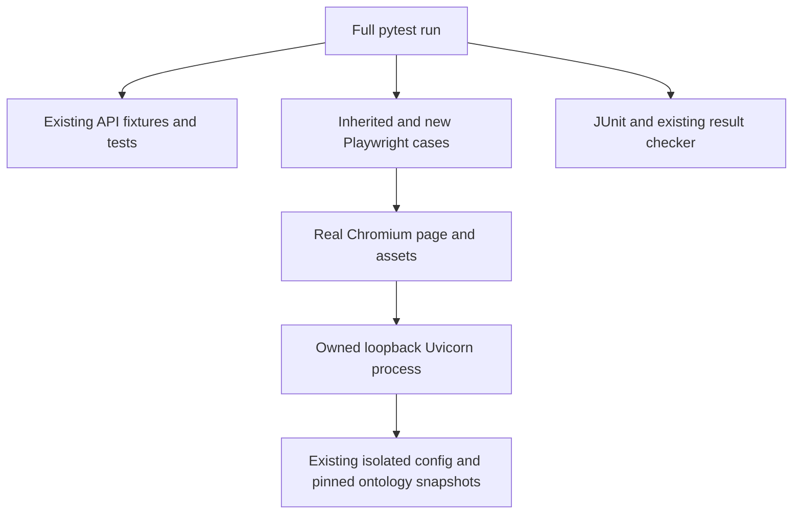
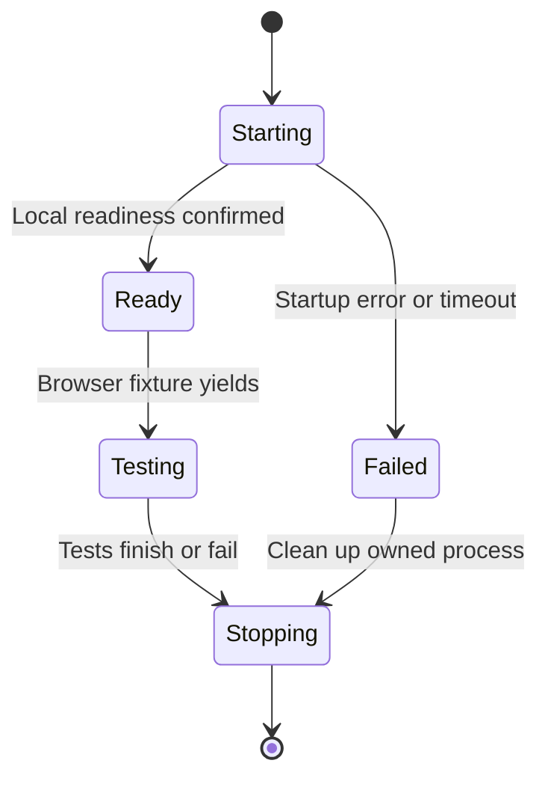

# fa-4 Graph Controls and Minimap Test Repair - Plan

## Goal Capsule

- **Objective:** Keyboard users can rely on the graph controls and minimap, and regressions in those interactions fail the repository's automated checks.
- **Means:** Preserve the recovered fa-2 implementation and browser assertions, make the browser suite part of normal verification, and add tests for keyboard activation and synchronized minimap output (KTD1–KTD4).
- **Authority:** The controller's fa-4 mandate governs scope. Campaign authority is the chief repository's `docs/plans/2026-10-26-0705-feat-codex-drawdown-campaign-plan.md`, Goal Capsule and Campaign R11/R15/R16/R17/R19/R20. Local context comes from `.planning/PROJECT.md`, `.planning/STATE.md`, the fa-2 plan, and current source.
- **Source limitation:** The chief repository is absent. Its original sections have not been read; only the campaign rules supplied with the mandate are available. P2 below must be resolved by the controller before build acceptance.
- **Execution profile:** One item and one replacement PR on `drawdown/fa-4`. This stage commits only this plan. The later build uses `lfg`, commits locally, and leaves publication to the controller. P1 must be resolved before implementation.
- **Who finishes:** The controller provides the verified fa-2 base, scans and publishes the completed branch, and opens a PR explicitly superseding #24. The campaign merge gate owns reviews and merge under Campaign R15/R19.
- **Stop conditions:** An unavailable source ref or blocked runtime check is an unresolved prerequisite, never a passing result. Apply R6/R7 throughout.

---

## Product Contract

### Summary

Repair fa-4 by retaining fa-2's accessible controls and passive minimap, preserving its existing tests, and adding discoverable browser regressions. Include the browser suite in reproducible full-suite verification and capture fresh Playwright evidence.

### Problem Frame

The mandate reports that PR #24 failed the expansion gate for adding no tests. Current `drawdown/fa-4` does not contain its feature commits, and neither fa-2 branch ref exists in the clone.

Local orphaned commits contain the feature and a substantial opt-in browser suite. That suite is named `browser_tests/entity_graph_controls.py`, which does not match pytest's default file patterns, while the current workflow explicitly runs only `tests/`. These are verified discovery gaps; they do not establish the gate's exact implementation or overturn its reported outcome.

### Requirements

**Preservation and behavior**

- R1. Base the build on verified `drawdown/fa-2` history and retain its controls, minimap, tests, and evidence while addressing only fa-4.
- R2. Add browser tests demonstrating keyboard operation of all seven existing graph controls through real focus traversal and native activation.
- R3. Add browser tests demonstrating that minimap output follows keyboard pan, zoom, and Fit, including offscreen recovery.
- R4. Preserve every existing test and assertion; all API and browser tests must pass before the replacement PR is accepted.

**Evidence and delivery**

- R5. Commit fresh Playwright screenshots of the feature on `/explore/tree` under `docs/plans/evidence/` and report their paths in the build handoff (Campaign R15/R16).
- R6. Keep this item on `drawdown/fa-4`; the controller publishes a PR that explicitly supersedes #24 (Campaign R17/R19).
- R7. Honor the supplied campaign hard stops and production exclusion: no production-box/config work, spend, credentials or security changes, sends, deletion without backup, force-push, prohibited secret-file reads, remote setup, migration, data rewrite, release, or new outside service (Campaign R11/R15/R16/R20).

### Scope Boundaries

This is a test and verification repair for existing fa-2 behavior. Production source changes are justified only by a failing regression that directly exposes a defect in that behavior, with the failing assertion retained.

Global graph shortcuts, keyboard navigation between graph nodes, interactive minimap navigation, new graph features, fa-1 history restoration, and infrastructure drift are outside this item. Replacing the renderer, introducing a JavaScript test toolchain, and rebuilding the browser harness around mocked DOM or layout are unnecessary: the recovered implementation already has real-browser coverage.

No new offline asset pipeline is planned. The browser page already uses Tailwind and Google Fonts; preserve that styling requirement and report a missing asset as a setup failure. A reproducible cached response for the same asset is acceptable, but an unstyled or substitute page is not evidence.

### Acceptance Examples

- AE1. **Covers R2/R4.** From the tab strip or dialog Close button, Tab reaches each graph control. Enter and Space each perform the corresponding action once, retain focus, and preserve selection and expanded children.
- AE2. **Covers R3.** Keyboard pan moves the graph fully out of view. The minimap still paints both graph and viewport, the summary reports zero visible nodes, and keyboard Fit restores the view and updates the map.
- AE3. **Covers R1/R4/R6.** A fresh checkout of the verified feature base collects the inherited browser cases and the new regressions, runs them alongside the API suite, and supplies evidence for a replacement PR identifying #24.

---

## Planning Contract

### Verified Starting State

Inspection was read-only. No tests, collection run, application startup, browser execution, or screenshot capture occurred during planning.

| Surface | Observed evidence | Consequence |
|---|---|---|
| Current branch | Clean `drawdown/fa-4` at `008ae8b8d3ea0a03cead603a2760d66b44b29d9e`; only `main` and `drawdown/fa-4` branch refs; no remotes | The controller must correct the build base without losing this plan or current history. |
| Recovered feature | Candidate `d6933a99fa2a554b9686ac4f627f935b14bdcf78`, with plan parent `568fd8215c56c8653f288d3b7076b17a2ee544d6` based on `beebde3` | Concrete fa-2 source is available locally, but its identity as PR #24's exact tip is unverified. |
| Earlier feature copy | `66b382705fa93e90d398cc5e256f1c977a8bec1f`; its browser-test directory and `entity_graph.js` are identical to the candidate | The same feature and assertions survive in multiple local histories. This is corroboration, not branch-ref provenance. |
| Recovered plan | `docs/plans/2026-10-27-0846-feat-accessible-graph-controls-minimap-plan.md` at the candidate | Defines native buttons and a passive overview; it explicitly excludes global graph shortcuts and interactive minimap actions. |
| Recovered tests | `browser_tests/entity_graph_controls.py` has 14 test functions by static inspection, including two parametrized functions | Preserve the suite. Its historical receipt reports 16 executed cases; that count is not a current test result. |
| Browser setup | Candidate `browser_tests/conftest.py` requires a supplied base URL; `pyproject.toml` already has the `browser` group and locked pytest-playwright | Reuse the dependency and assertions. Automate isolated local app startup rather than adding another runner. |
| API isolation | Current `tests/conftest.py` and `tests/support.py` install nonsecret config, pinned FOLIO/Canon snapshots, provider rejection, and HTTPX guards before application imports | Reuse these inputs in the browser app subprocess; preserve API fixture ownership and lifespan behavior. |
| CI | `.github/workflows/api-tests.yml` runs `pytest tests` and `scripts/check_pytest_results.py` | Add browser setup and collection without narrowing existing coverage or the zero-skip gate. |

No repository or ancestor `AGENTS.md`/`CLAUDE.md` was present in the exposed checkout. The supplied standing instructions govern this run.

### Blocking Prerequisites

- **P1 — Feature-base provenance:** The controller must expose the actual fa-2 ref and establish which recovered commit matches it. Provide a fa-2-based `drawdown/fa-4` checkout carrying this plan, preserving the current branch tip and unrelated work. Compare the recovered source with that ref before using the selectors and cases below. Do not reconstruct the feature from main or silently choose an orphan as the authoritative PR tip.
- **P2 — Campaign authority:** The controller must supply or verify only the chief plan's Goal Capsule and Campaign R11/R15/R16/R17/R19/R20. The same source limitation appears in the recovered fa-2 plan and receipt; neither establishes that the original authority was checked.

These are controller provisioning tasks, not requests for a login, credential, or product decision from Damien. They leave the build conditional even though the plan can be committed now.

### Assumptions

- AS1. The verified fa-2 ref retains the candidate's native-control contract and existing browser suite. If it differs, revise the affected test expectations from the verified source before implementation.
- AS2. A controller or CI runner can execute local sockets, Uvicorn, and Chromium. This sandbox's denied Unix sockets cannot supply integration acceptance evidence.
- AS3. The existing Tailwind/font assets remain available during browser verification, or the same assets can be served from a faithful test cache. No provider or live ontology access is required.

### Key Technical Decisions

- KTD1. **Repair collection without moving or deleting tests.** For R1/R4, retain `browser_tests/entity_graph_controls.py` intact and add its exact filename to pytest's collection patterns alongside both default patterns, `test_*.py` and `*_test.py`. Put new cases in `browser_tests/test_entity_graph_controls.py`. The full-suite command names both `tests` and `browser_tests`; an API-only command remains a subset, not full verification.
- KTD2. **Run one owned, isolated local app for browser tests.** For R4/R7, extend the browser fixtures to start a loopback-only Uvicorn subprocess with `tests.support.isolated_environment()` entered before application import. Use the existing snapshots and real API/MCP lifespans. Keep this subprocess separate from the API suite's session TestClient, wait for readiness with a bounded timeout, and stop only the process the fixture owns. Retain explicit local-base-URL use for the existing manual workflow. No socket, logging, or security-policy bypass is acceptable.
- KTD3. **Assert native actions and observable results.** For R2/R3, use role/name locators, real Tab/Shift+Tab traversal, and `page.keyboard` activation. Observe numerical camera changes, selected IRI, expanded state, and request counts. Use the inherited DOM/pixel minimap oracle as supporting evidence and add before/after assertions that expose stale drawing. Keep real ELK, graph DOM, CSS transforms, and canvas rendering. This follows [Playwright keyboard input](https://playwright.dev/python/docs/api/class-keyboard) and [focus assertions](https://playwright.dev/python/docs/api/class-locatorassertions#locator-assertions-to-be-focused).
- KTD4. **Extend the existing CI gate.** For R4/R5, install the existing locked `browser` group and matching Chromium before the full suite. Preserve API coverage and the report checker's rejection of missing, failed, errored, empty, or skipped results. Use the same browser cache location for installation and execution. [Playwright browser guidance](https://playwright.dev/python/docs/browsers) treats browser binaries as a separate installation prerequisite.
- KTD5. **Preserve campaign delivery choices.** For R6/R7, guarded expansions proceed through the controller and campaign reviews (session-settled: user-directed — chosen over holding every expansion for personal review: the campaign authorizes guarded delivery). Local work uses Astra rather than the Sol-first ladder; cloud builds use default Sol with Astra/Fable reviews. The historical zero-user-time instruction through 2026-10-30 is not a new approval gate. Durable hygiene, rather than speculative features, remains the standing fallback after assigned work.

### Behavior Trace

In the recovered implementation, native button clicks mutate the existing camera and call `applyTransform`, which updates the DOM and overview. The minimap projects the union of graph and camera bounds. Its summary reports visible nodes and zoom; a separate polite status region updates after discrete button commands. Full screen reparents the same pane, and resizing refreshes overview geometry without resetting the camera.

The API test harness enters its isolation context during pytest configuration, before application import. Its session client starts the real lifespan and waits for the ontology registry. The proposed browser subprocess uses the same input isolation but owns its own application lifecycle. This avoids trying to serve the TestClient's async resources on another event loop.

### High-Level Technical Design

The local app belongs to the browser fixture and cannot outlive its verification session.

---

## Implementation Units

### U1. Make inherited graph tests discoverable and reproducible

**Goal:** A full-suite invocation includes existing API assertions and all inherited browser cases without manual app startup.

**Requirements:** R1/R4/R6/R7; AE3; KTD1/KTD2/KTD4/KTD5.

**Dependencies:** P1/P2 resolved and the verified base re-inspected.

**Files:** `pyproject.toml`, `browser_tests/conftest.py`, `browser_tests/serve_app.py` (new), `browser_tests/README.md`, `README.md`, `.github/workflows/api-tests.yml`.

**Approach:**

1. Apply additive collection patterns under KTD1. Compare collected node IDs with the explicit legacy module invocation; every inherited case must remain present exactly once in the full run.
2. Add the small test-only server entry point and owned-process fixture under KTD2. Missing snapshots, failed readiness, or missing Chromium fail clearly; they never become skips.
3. Extend the existing workflow's locked install, browser prerequisites, and full-suite command under KTD4. Keep its report checker, API coverage, triggers, and permissions. Extend report uploads to include browser diagnostics.
4. Document automatic startup and the retained explicit local-server command. Record the browser styling dependency under AS3.

**Patterns to follow:** `tests.support.isolated_environment`, `tests/fixtures/README.md`, the inherited browser fixtures, and `.github/workflows/api-tests.yml`.

**Test scenarios:**

1. Full collection contains every pre-existing API case and every inherited browser parametrization exactly once.
2. A fresh runner with locked dependencies and Chromium reaches the real tree page and completes the unintercepted class/property browser smoke using pinned local ontology data.
3. An unavailable local server or missing browser produces a failed check with useful diagnostics; the runner does not hang or skip the suite.
4. Normal completion and browser-test failure both stop the owned subprocess without touching an independently supplied local server.

**Verification:** Full collection and the inherited suites succeed through the new setup. This unit changes test infrastructure; the existing route and browser integration cases verify it, rather than adding source-text assertions about configuration.

### U2. Add keyboard and minimap regressions

**Goal:** New tests fail when a native graph command stops working or leaves the overview stale.

**Requirements:** R2/R3/R4; AE1/AE2; KTD3.

**Dependencies:** U1.

**Files:** `browser_tests/test_entity_graph_controls.py` (new); additive fixture helpers in `browser_tests/conftest.py` only if needed. Reuse the existing public graph fixture and helpers in `browser_tests/entity_graph_controls.py` without deleting or weakening their assertions.

**Approach:** Use characterization tests against verified fa-2 behavior before considering any source fix. Start from a loaded, measurable graph with children expanded and a nondefault camera. Await rendered state with bounded assertions or animation-frame polling, not fixed sleeps. Keep the new module conventionally named and included in U1's full collection.

**Test scenarios:**

1. Covers AE1. Parameterize all seven named controls over Enter and Space in embedded and full-screen modes. Reach each by native traversal from the preceding tab-strip/dialog control, assert visible focus, activate once, and retain focus afterward. Four pan actions have the source-defined 80 CSS-pixel effect; zoom changes scale by 1.12 or its inverse around the viewport center; Fit restores useful framing from a deliberately displaced view.
2. Preserve selected IRI, expanded children, and graph-request count through those actions. Compare observable before/after values rather than merely finding buttons or event-handler text.
3. At the 20% and 400% zoom limits, keyboard activation is inert and `aria-disabled` is true while the control stays focusable. Keep this distinct from a native disabled-control expectation.
4. Covers AE2. At device pixel ratios 1 and 2, use keyboard pan, zoom, and Fit and verify both actual minimap paint and viewport geometry after each relevant action. Pan fully offscreen, require zero-visible recovery text and both graph/view representations, then use keyboard Fit and assert recovered geometry and summary.
5. Following expansion and a full-screen round trip, one keyboard action still has one camera effect and one current overview. This catches duplicate handlers and stale canvas references while retaining the inherited lifecycle tests.

**Patterns to follow:** The inherited `camera`, `assert_map_contains_graph_and_view`, graph payload, and native-control tests. Verify source contracts: `#graph-controls`, `#graph-minimap`, `#graph-view-summary`, and `#graph-view-announcement`.

**Verification:** The new cases perform real keyboard actions and inspect rendered outcomes. This covers browser interaction and rendering, not manual screen-reader output or whole-page accessibility certification.

### U3. Record fresh full-suite and visual evidence

**Goal:** The controller receives a reviewable repair with current results and screenshots.

**Requirements:** R1/R4/R5/R6/R7; KTD4/KTD5.

**Dependencies:** U2.

**Files:** `browser_tests/test_entity_graph_controls.py`, `browser_tests/README.md`, `docs/plans/evidence/fa-4-graph-controls-embedded.png` (new), `docs/plans/evidence/fa-4-graph-controls-fullscreen.png` (new), `docs/plans/evidence/fa-4-verification.md` (new).

**Approach:**

1. Capture fresh screenshots after behavioral assertions, with controls, visible keyboard focus, expanded graph, and minimap in view. Use separate fa-4 filenames; preserve fa-2 evidence.
2. Run the full-suite and result-checker contract below on the verified feature base plus repair. Record commands, source SHA, actual counts, failures/skips, browser version, and screenshot provenance.
3. State that the controller's new PR supersedes #24 and preserves fa-2. Include the verified base SHA and distinguish inherited tests from added cases. Do not claim publication from this remote-free clone.

**Test scenarios:**

1. Both API and browser assertions finish successfully, with a nonempty JUnit report accepted by the existing checker and no skipped cases.
2. Embedded and full-screen screenshots show the actual styled local route, not replacement HTML. The receipt identifies synthetic graph responses and the unintercepted ontology smoke separately.

**Verification:** The evidence belongs to this repair's tested commit. Historical fa-2 results and screenshots are retained as history, not reused as fresh acceptance.

---

## Verification Contract

These are build-stage checks, not actions performed by this plan stage. Full verification includes both test directories.

| Check | Build-stage command or evidence | Required outcome |
|---|---|---|
| Locked environment | `uv sync --locked --dev --group browser --python 3.12` | Existing locked API and browser dependencies install without unrelated upgrades. |
| Browser prerequisite | `uv run --no-sync python -m playwright install --with-deps chromium` | Matching Chromium is available on the capable runner; use the same cache location for testing. |
| Discovery | `uv run --no-sync pytest tests browser_tests --collect-only -q` | Every inherited case and all new regressions are collected once. |
| Full suite | `uv run --no-sync pytest tests browser_tests -ra --junitxml=test-results/pytest.xml --browser chromium` | Complete successful exit with API coverage retained; owned local app startup is automatic. |
| Report gate | `uv run --no-sync python scripts/check_pytest_results.py test-results/pytest.xml` | No missing, malformed, empty, skipped, failed, or errored report; this supplements the full pytest exit. |
| Visual proof | Fresh fa-4 screenshots and `docs/plans/evidence/fa-4-verification.md` | Styled embedded and full-screen states, matching the tested commit. |

Retain the existing screenshot-directory option for reproduction. Write any inherited fa-2 screenshot output to a temporary results directory so historical committed images are not overwritten. Copy only the newly captured fa-4 images into their declared evidence paths.

The sandbox may prevent sockets or Chromium from running. Record any actual failure and route verification to the controller's capable runner without changing restrictions, disabling tests, or substituting static checks. The existing lesson in `docs/solutions/developer-experience/2026-09-19-codex-worker-sandbox-cannot-run-pytest-or-app.md` remains a warning about evidence quality, not a current pass/fail result.

---

## Definition of Done

- P1/P2 are resolved, and the build preserves the verified fa-2 source and every inherited test under R1/R4.
- U1's normal collection and CI include the inherited browser suite and U2's added keyboard/minimap regressions.
- The complete verification contract passes on a capable runner, and U3's fresh screenshots and receipt are committed.
- The controller opens the replacement PR explicitly superseding #24; campaign reviews and merge remain with the gate under R6/R7.
- Unrelated work and historical evidence remain intact. No abandoned experimental additions are included in the final diff.
- No held change or user decision is expected. Controller source provisioning and runtime evidence remain prerequisites until actually supplied.
