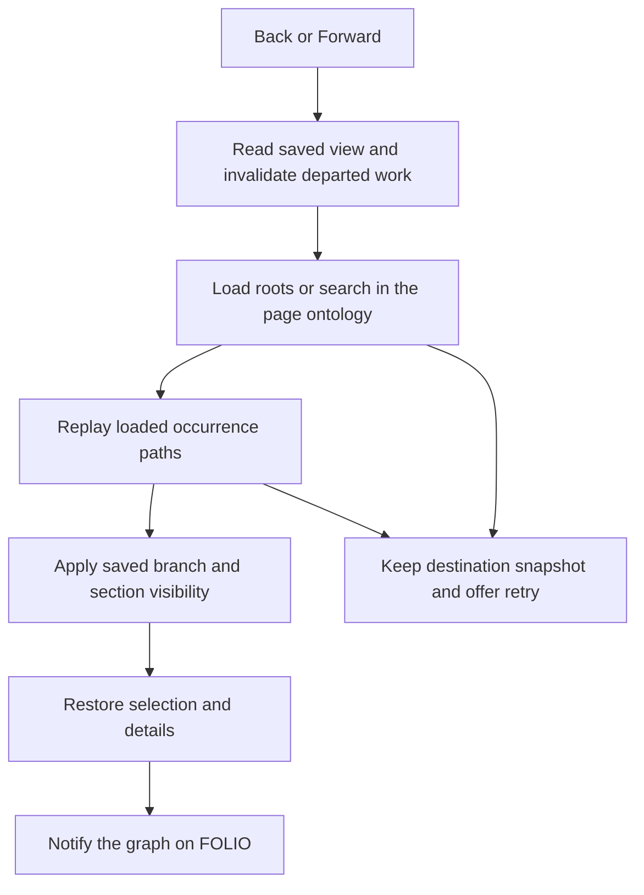

# Land Explorer Browser History on Current Main - Plan

## Goal Capsule

- **Objective:** Explorer users can use browser Back and Forward to recover their query, expanded branches, and selected concept.
- **Means:** Replay PR #33 and integrate its history implementation and tests with the supplied newer baseline (KTD1-KTD4).
- **Authority:** The supplied mandate selects expansion `fa-5`. The chief repo's `docs/plans/2026-10-26-0705-feat-codex-drawdown-campaign-plan.md` governs the campaign; its Goal Capsule and campaign R11, R15, R16, R17, R19, and R20 are the required excerpt. The September origin plan establishes existing navigable-search behavior.
- **Authority availability:** The chief repo and `ops/drawdown/mandates/_common.md` were not available in this sandbox. Campaign mappings here come from the supplied mandate. The controller must reconcile the required excerpt before build dispatch; no credential or production access is needed.
- **Execution profile:** Standard depth, three dependent units, one branch `drawdown/fa-5`, one successor PR that supersedes #33. This stage commits only this plan.
- **Who finishes:** The build lane implements, simplifies, reviews, verifies, and commits locally. The controller scans, pushes, and opens the successor PR; the campaign gate handles merging under campaign R15/R19. The lane adds no remote and seeks no login.
- **Stop conditions:** A missing source commit stops the landing. Unavailable verification is an unresolved gate, never a passing result. Production access, credentials, migrations, data rewrites, releases, or new outside services are outside this item.

---

## Product Contract

### Summary

Land the existing browser-history feature on the supplied current code while preserving FOLIO/Canon routing. Retain the PR's implementation and regression tests, add integration coverage, and collect fresh verification evidence.

### Problem Frame

The September navigable-tree work left browser history as a follow-up. PR #33 implements that behavior, but its branch predates the Canon toggle and newer dependencies. Replaying it without reconciling those changes could restore the wrong ontology or discard current fixes. A plan or historical test receipt alone would leave the browser behavior unchanged.

### Requirements

**Feature landing and preserved behavior**

- R1. The finished branch carries PR #33's source and test changes from `e377968c0c1a4aa4bd4fa55ba8efd2876e18242a`, reconciled with the current baseline.
- R2. Back and Forward restore query, expanded/collapsed occurrences, revealed sibling context, selected occurrence, and details for both class and property trees.
- R3. Preserve the source history contract: entry boundaries, legacy/deep links, empty selection, duplicate occurrences, failed restoration/retry, and rejection of stale asynchronous work. The source fa-1 plan's R1-R10 and AE1-AE7 remain acceptance obligations.
- R4. Preserve current FOLIO/Canon behavior, including ontology-scoped requests and URLs, full Canon IRIs, switching to the other ontology's roots, blocked Canon pages, and Canon's graph exclusion.
- R5. Keep the September origin plan's R1-R15 and existing tests intact; only its explicitly deferred history behavior is extended.

**Verification and delivery**

- R6. Retain every existing test and assertion, including the imported browser tests, and add tests for the integration and both traversal directions (campaign R15/R16).
- R7. The complete current pytest suite and the standalone browser suite pass on the final candidate. Fresh Playwright screenshots are committed under `docs/plans/evidence/`; source PR screenshots and receipts are historical evidence.
- R8. Deliver this expansion on `drawdown/fa-5` only. The build handoff names the successor PR as superseding #33 and includes the source/test diff and verification evidence (campaign R17/R19).
- R9. Apply campaign R11/R20 and the mandate's publication boundaries: no forbidden file reads, credential/security changes, spend, sends in the owner's voice, unbacked deletion, force-push, production changes, schema/data changes, package release, or new outside service.

### Acceptance Examples

- AE1. **Covers R2/R6.** Given adjacent committed views with different queries, selections, and expanded branches, Back restores every saved field of the first view and Forward restores every saved field of the second. Run this for classes and properties.
- AE2. **Covers R3/R5.** A returned view retains hidden siblings' loaded descendants, collapsed sections, and the selected duplicate occurrence. Releasing a delayed request from a departed view cannot alter that destination.
- AE3. **Covers R4/R6.** On Canon, follow a class-to-property details link using full IRIs with matching local names in different namespaces. Back and Forward restore the correct entity and type, with every request still scoped to Canon.
- AE4. **Covers R4/R6.** Switching from FOLIO to Canon opens Canon roots. Back returns to the saved FOLIO document and Forward to Canon; the heading, ontology selector, and graph availability match each document.
- AE5. **Covers R3/R4.** Clear or collapse removes both selection URL parameters while retaining Canon and unrelated parameters. FOLIO removes its redundant ontology selector; restoration does not append an entry or replace the destination with partial state.
- AE6. **Covers R4/R6.** A blocked Canon page retains its server-rendered status and disabled controls, with no tree requests or history restoration started.

### Scope Boundaries

The change is the `fa-5` landing and compatibility work on `/explore/tree`. R9 owns the operational exclusions. Other mandate items, including graph accessibility/minimap and CI expansion, are outside this branch.

A new router, cross-ontology snapshot schema, saved-search service, graph viewport persistence, and a general retry redesign are considered unnecessary: the existing page navigation and imported history mechanisms cover the requested behavior. Reconsider only if a concrete failing integration case cannot be addressed within those mechanisms. Browser restart persistence is not an acceptance claim.

---

## Planning Contract

### Verified Starting State

Inspection was read-only. No tests, browser sessions, application startup, dependency installation, or cherry-pick was run; these findings do not establish a passing baseline.

| Evidence | Finding |
|---|---|
| Supplied branch | Clean `drawdown/fa-5` at `53a615e9af07f2b6b67d13d99808ead8caa69212`. |
| Local `main` | `36a0e97a61b5115e167829ee44cce4096c7e887c` is an ancestor of the supplied HEAD, so it is an older comparison ref. |
| PR #33 source | Commit `e377968c0c1a4aa4bd4fa55ba8efd2876e18242a` exists. Its common ancestor with supplied HEAD is `39aeca15b700fe6241df01d064d435fa5119f0ad`; the replay range contains 12 commits. |
| Current frontend changes since that ancestor | `folio_api/static/js/unified_tree.js` added Canon routing, full-IRI handling, URL normalization, and a blocked-page guard. `entity_graph.js` has no intervening changes in this range. |
| Imported browser tests | Source contains 45 tree and 11 graph test methods under `tests/browser/`. Their `*_browser.py` names keep them outside ordinary pytest discovery. These are source counts, not execution results. |
| Current runtime | `pyproject.toml` requires Python `>=3.13,<4.0.0`, `folio-python[search,kaos]>=0.4.2`, and `folio-mcp[kaos]>=0.4.5`. The source adds only the browser dependency group. |
| Instructions and delivery | No repository or visible ancestor `AGENTS.md`/`CLAUDE.md` was found. There is no remote. The supplied lane instructions govern. |

The source range also includes its original plan, screenshots, verification receipt, and two session-recovery notes. Its `860423e` auto-save commit contains source changes as well as those notes; omitting that commit by its title would lose implementation work.

### Assumptions

- The controller supplied `53a615e` deliberately as the integration baseline. Preserve it; do not move the lane backward to the stale local `main`. The controller confirms the current publication base before opening the successor PR.
- The source browser harness remains suitable after adding current template context and ontology-distinct fixtures. Actual compatibility and available browser/runtime support are build-time checks.
- The source snapshot format remains sufficient within each server-rendered ontology document. Ontology switching keeps ordinary document navigation; no new client-side ontology state machine is assumed.

### Key Technical Decisions

- KTD1. **Replay the complete authorized range on the supplied branch.** Use the mandate's merge-base-to-source-head cherry-pick range, preserving current code plus the PR's intent at every conflict. Do not replace the current JS or lock file wholesale. Check the feature diff against both local `main` and the verified starting commit so unrelated baseline advances cannot masquerade as delivered work. Supports R1/R8.
- KTD2. **Retain the source snapshot and ownership design.** `captureView`, `savedView`, `writeView`, and `restoreHistory` own occurrence-based snapshots and entry writes. The tree's navigation generation and graph's selection/layout ownership reject stale work. Reuse these mechanisms for R2/R3; a new architecture would make the landing harder to verify.
- KTD3. **Carry current ontology routing through every rewritten path.** Preserve `ontologyUrl`, `extractIdFromIri`, and `treeBlocked` in the imported loaders, including new `childData`, `fetchSearch`, selection URLs, details fallback, path lookup, and restore/retry. URL normalization must preserve the destination snapshot and entry count. The server-rendered page remains the ontology owner. Supports R4.
- KTD4. **Keep test isolation and current dependencies.** Add the source's test-only `browser` group to the current manifest and reconcile `uv.lock` under Python 3.13 without reverting current dependency requirements. Preserve the standalone Playwright/unittest harness and deterministic response barriers. Supports R6/R7.
- KTD5. **Separate historical provenance from current acceptance.** Keep the source plan and evidence identifiable as historical. Review imported `.planning/.continue-here.md` and `.planning/HANDOFF.json` as stale recovery metadata, not active instructions. Preserve newer current notes; verify source versions are recoverable from the supplied commit before removing or replacing imported notes. Make imported text public-safe with repo-relative paths. Supports R1/R8/R9.
- KTD6. **Keep guarded delivery.** Expansions proceed through the campaign merge gate (session-settled: user-directed — chosen over holding expansions for owner review: the mandate settles delivery). Local work uses Astra (session-settled: user-directed — chosen over the Sol-first ladder: the campaign settles the model choice). Cloud builds use the default model with Astra and Fable reviews retained (session-settled: user-directed — chosen over applying the local model choice to cloud builds: the campaign distinguishes those environments). Supports R8.
- KTD7. **Keep the campaign's scope and availability decisions.** The stated no-wait window through 2026-10-30 remains historical campaign context (session-settled: user-directed — chosen over waiting for owner decisions: the campaign established that window). Exhausted authorized work leads to durable hygiene (session-settled: user-directed — chosen over speculative features: the campaign limits expansion). This plan does not activate either a new waiting period or another mandate item.

### High-Level Technical Design

The imported restore sequence stays intact; KTD3 applies ontology routing at each data boundary.

The mode boundary remains server-owned:

| Page context | Request and URL handling | History initialization | Graph |
|---|---|---|---|
| FOLIO ready | Default ontology; normalize away redundant FOLIO selector | Restore saved view or legacy URL | Existing graph follows selection |
| Canon ready | Keep `ontology=canon` and full IRIs | Restore saved view or legacy URL | Absent |
| Canon blocked | Preserve server status | Do not start | Absent |

### Risks and Deferred Execution Checks

Conflict locations are predicted from diffs; the actual replay and lock resolution have not been attempted. Current Canon tests validate server behavior but cannot prove that the imported JavaScript keeps its routing.

Unix sockets are denied in the lane. Browser startup and parts of pytest may therefore need the controller's supported runtime. Record the real failure and carry the gate forward; never change socket behavior, monkeypatch the application, or weaken assertions to manufacture a pass. This follows `docs/solutions/developer-experience/2026-09-19-codex-worker-sandbox-cannot-run-pytest-or-app.md`.

### Sources and Research

- Source head `e377968c0c1a4aa4bd4fa55ba8efd2876e18242a`: `docs/plans/2026-10-26-1206-feat-fa-1-browser-history-plan.md`, its R1-R11/AE1-AE7, source JS, and `tests/browser/`.
- Current `folio_api/templates/jinja2/explore/tree.html` and `tests/routes/test_canon_tree.py`, `test_canon_page.py`, and `test_canon_footer.py`: ontology mode, switch-to-roots behavior, full identifiers, and graph exclusion.
- Current `pyproject.toml`, `README.md`, `.github/workflows/api-tests.yml`, and `scripts/check_pytest_results.py`: runtime and complete-suite verification requirements.
- The source `tests/browser/README.md`: standalone suite invocation, deterministic fixtures, local presentation resources, and screenshot prerequisites.

---

## Implementation Units

### U1. Replay PR #33 without reverting the supplied baseline

**Goal:** Bring the existing history implementation and its tests onto `drawdown/fa-5`.

**Requirements:** R1/R3/R5/R6/R8/R9; KTD1/KTD2/KTD4/KTD5/KTD6/KTD7.

**Dependencies:** None; re-verify branch, starting history, and source object before modifying files.

**Files:** `folio_api/static/js/unified_tree.js`, `folio_api/static/js/entity_graph.js`, `pyproject.toml`, `uv.lock`, `tests/browser/support.py`, `tests/browser/tree_history_browser.py`, `tests/browser/graph_history_browser.py`, `tests/browser/README.md`, and the source plan/evidence/session notes identified above.

**Approach:**

1. Replay the full source range and reconcile conflicts under KTD1.
2. Preserve current dependency requirements while adding the source browser test group.
3. Review imported documentation under KTD5 and retain all source test scenarios.

**Patterns to follow:** Source history capture/restore and graph ownership helpers; current manifest and test-environment isolation.

**Test scenarios:**

1. Existing query/selection, duplicate-occurrence, branch visibility, and retry regressions remain present.
2. Existing graph tests still exercise active/lazy selection, empty selection, and delayed fetch/layout/frame cancellation.
3. Current Canon route tests and API/application-start tests remain unchanged.

**Verification:** The branch contains both source JS changes and browser tests beyond the starting commit. Lock resolution retains the current runtime. U2/U3 complete behavioral verification; a clean replay alone is not acceptance.

### U2. Preserve FOLIO/Canon behavior through history restoration

**Goal:** Keep ontology selection and identifiers correct while applying the imported history design.

**Requirements:** R2/R3/R4/R5/R6; AE3-AE6; KTD2/KTD3.

**Dependencies:** U1.

**Files:** `folio_api/static/js/unified_tree.js`, `tests/browser/support.py`, `tests/browser/tree_history_browser.py`, `tests/browser/graph_history_browser.py`. Use the current tree template and Canon route tests as preservation references.

**Approach:**

1. Apply KTD3 to all rewritten request and history boundaries.
2. Render explicit `ontology_key`, `canon_state`, and `tree_status` in fixtures. Serve distinct documents and entity data for FOLIO and Canon; reject missing or incorrect ontology routing.
3. Preserve Canon graph exclusion and blocked initialization without changing the toggle into a client-side router.

**Execution note:** Add failing integration cases for the ontology boundaries before adapting the imported helpers.

**Test seam:** The browser tests exercise real templates and scripts against synthetic responses. They catch frontend routing and state mistakes; the existing pytest route tests cover actual server contracts.

**Test scenarios:**

1. Covers AE3: Canon class/property traversal preserves full, namespace-distinct IRIs through search, details links, fallback, Back, and Forward.
2. Covers AE4: FOLIO-to-Canon navigation opens roots; Back/Forward restores the correct document context and graph availability.
3. Covers AE5: Clear/collapse and legacy URLs normalize ontology and selection parameters, preserve unrelated parameters, and keep history length and saved destination state correct.
4. Covers AE6: Blocked Canon starts no tree request or restoration and retains disabled controls.
5. A delayed Canon response released after traversal cannot alter the destination or escape ontology routing.

**Verification:** All added integration cases pass with request and entity-identity assertions. The existing Canon pytest tests and FOLIO graph browser tests continue passing.

### U3. Prove both traversal directions and record fresh acceptance

**Goal:** Demonstrate the integrated feature on the final candidate.

**Requirements:** R2/R3/R6/R7/R8; AE1/AE2; KTD4/KTD5/KTD6.

**Dependencies:** U1/U2.

**Files:** `tests/browser/tree_history_browser.py`, `tests/browser/graph_history_browser.py`, `tests/browser/README.md`, `docs/plans/evidence/fa-5-tree-history-back.png`, `docs/plans/evidence/fa-5-tree-history-forward.png`, `docs/plans/evidence/fa-5-history-verification.md`.

**Approach:** Strengthen the primary traversal test so both destination entries have independently asserted branch state. Capture screenshots after behavioral assertions, using fresh fa-5 filenames. Record the tested revision, commands, results, and any remaining environment gate in the receipt.

**Patterns to follow:** Source `hold`/`fail_next` barriers, unexpected-request/JavaScript-error checks, and opt-in screenshot capture. Keep all imported race and failure assertions.

**Test scenarios:**

1. Covers AE1: Both class and property journeys assert the query, expanded occurrence, selected identity, and details after Back and after Forward.
2. Covers AE2: Run the existing hidden descendants, duplicate occurrences, interrupted restore, and stale details/graph work scenarios.
3. Styled screenshots visibly show the restored Back and Forward states after those assertions pass.

**Verification:** Every applicable check in the Verification Contract passes on the final candidate. The receipt and final handoff distinguish current results from imported historical evidence and state that the successor PR supersedes #33.

---

## Verification Contract

The following commands describe future build acceptance; none ran during planning.

| Check | Command or evidence | Completion condition |
|---|---|---|
| Locked environment | `uv sync --locked --dev --group browser --python 3.13` | Coherent current runtime plus browser dependencies; no unresolved lock changes. |
| Full pytest suite | `uv run --no-sync pytest tests -ra --junitxml=test-results/pytest.xml` | Complete process succeeds, retaining all current tests. |
| Pytest report gate | `uv run --no-sync python scripts/check_pytest_results.py test-results/pytest.xml` | Valid nonempty report with no skipped, failed, or errored tests. |
| Browser prerequisites | Chromium and the source README's pinned local Tailwind resource | Available without credentials or a live API; caches use `XDG_CACHE_HOME`. |
| Standalone browser suite | `uv run --no-sync python -m unittest discover -s tests/browser -p '*_browser.py' -v` | Both imported suites and all integration additions pass; missing prerequisites are failures, not skips. |
| Visual verification | Repeat browser acceptance with `FOLIO_BROWSER_SCREENSHOTS=1` and `FOLIO_BROWSER_TAILWIND` configured | Inspect and commit the two fresh U3 screenshot paths with the restored state visible. |
| Change and delivery review | Compare against the verified starting commit and the controller's current main; inspect source/test and documentation changes | Feature is present; current changes and tests survive; no unrelated item or operational changes enter the successor PR. |

The source browser README pins Tailwind 3.4.17 with SHA-256 `afcd5f979c919a39cdfafefe983bde4f5bd41caab98cb2eb0efd2cf56b8d1355`. A behavioral run without that presentation resource is not visual verification.

The build workflow applies `lfg` to this plan and completes simplification/review locally. Controller publication and campaign reviews remain required even though this clone has no remote. Environment failures must be rerun in a supported environment before R7 can be declared complete.

---

## Definition of Done

- U1-U3 satisfy R1-R9, including the source/test diff required by `fa-5`.
- Current baseline features, dependency requirements, and every existing test remain intact.
- The full pytest/report gate and standalone browser suite pass on the final candidate, with fresh committed screenshots and a truthful receipt.
- The final source/test diff contains no abandoned experimental code, unrelated mandate work, or operational changes.
- Imported text and new artifacts use repo-relative paths and contain no private or credential material.
- The controller receives the local branch, plan path, `KIND: expansion`, screenshot paths, and the explicit statement that the new PR supersedes #33.
- A branch containing only this plan or a historical receipt is not a completed build and must not be published as the finished `fa-5` item.
