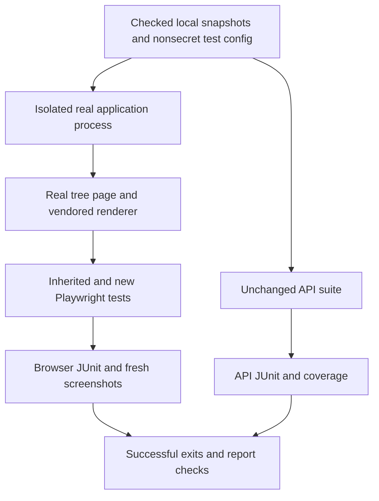

# Land Graph Controls with Regression Coverage - Plan

## Goal Capsule

- **Objective:** FOLIO users can navigate the entity graph by keyboard and stay oriented through an accurate minimap.
- **Means:** Restore the supplied PR #24 implementation on the lane's newer baseline and add executable regression coverage (KTD1-KTD4).
- **Authority:** The controller's `fa-6` mandate and campaign standing rules govern this item. Campaign authority is the chief repository's `docs/plans/2026-10-26-0705-feat-codex-drawdown-campaign-plan.md`, Goal Capsule and Campaign R11, R15, R16, R17, R19, R20. Local context comes from `.planning/PROJECT.md`, `.planning/STATE.md`, the supplied PR head, and current source.
- **Authority limitation:** The chief repository and `ops/drawdown/mandates/_common.md` are absent from this clone. The original campaign sections could not be read; this plan uses the controller-provided rules. The controller must compare those sections before build dispatch. No repository or ancestor `AGENTS.md`/`CLAUDE.md` was found in the exposed workspace.
- **Execution profile:** One expansion on `drawdown/fa-6`, delivered as one replacement PR. This stage writes and commits only this plan. The subsequent build runs `lfg` on it and commits source, added tests, and evidence locally under R6-R8.
- **Who finishes:** The controller scans, pushes, and opens the replacement PR; it supersedes #24 and #34. The campaign merge gate owns review and merge (Campaign R15/R19).
- **Stop conditions:** A missing supplied commit stops the build under the mandate. Blocked runtime verification remains incomplete under R5; any prohibited or held change follows R7-R8.

---

## Product Contract

### Summary

Land the existing accessible graph controls and minimap on the supplied integration baseline. Preserve the PR's tests, add focused keyboard and minimap regressions, and make the complete browser verification reproducible alongside the existing API suite.

### Problem Frame

The campaign rejected earlier graph work for missing tests. The supplied head now contains browser tests, but their nonstandard filename excludes them from default discovery, and the current CI command only runs `tests/`. Historical receipts therefore cannot establish that the replacement branch works on today's code.

The current graph surface lacks the PR's native viewport controls and synchronized overview. Users still depend on pointer navigation, despite the controls/minimap item remaining in `.planning/STATE.md`'s deferred list.

### Requirements

**Restore the user experience**

- R1. Carry the source and test changes from `efb88fa54bcaa47b274486f3e9d96f8376d71da0` into the replacement branch, preserving current baseline behavior when resolving conflicts.
- R2. Preserve named native pan, zoom, and Fit buttons, keyboard focus, zoom limits, and view announcements in embedded and full-screen modes.
- R3. Preserve the passive minimap and readable view summary, synchronized with navigation, expansion, node movement, resizing, and pane transitions.
- R4. Retain graph lazy loading, tree selection, child expansion, pointer navigation, Canon's existing page behavior, and every existing test without deleting, skipping, or weakening assertions.

**Prove and deliver the change**

- R5. Add behavioral tests for keyboard controls and the minimap; acceptance requires the full existing API suite and both inherited and new browser tests to pass with no skipped verification.
- R6. Commit fresh Playwright screenshots of the changed `/explore/tree` page under `docs/plans/evidence/`, together with reproducible results from the replacement branch (Campaign R15/R16).
- R7. Keep work limited to `fa-6` on `drawdown/fa-6`; no production-box/config-drift changes, schema migration, data rewrite, package release, or new outside service (Campaign R16/R17).
- R8. Commit locally without adding a remote, finding credentials, or publishing from the lane; observe the campaign's hard stops and public-safe writing rules (Campaign R11/R15/R19/R20).

### Key Decisions

- **Guarded expansion delivery.** Governs R5-R8 (session-settled: user-directed — chosen over holding expansions for personal review: campaign tests and review gates authorize delivery).
- **Campaign execution choices remain fixed.** Governs R8: local work uses Astra rather than the Sol-first ladder; cloud builds use default Sol with Astra/Fable reviews rather than a cloud model override (session-settled: user-directed — chosen over those alternatives: the campaign specifies the execution and review split).
- **Assigned work stays bounded.** Governs R7: durable hygiene follows exhausted mandates rather than speculative features (session-settled: user-directed — chosen over speculative expansion: the campaign limits the backlog). The historical no-user-time direction through 2026-10-30 is not a new blocker or a reason to reopen settled decisions.

### Scope Boundaries

This item restores the existing design and supplies missing regression proof. Necessary conflict repairs and defects exposed by these tests belong in the owning graph files.

Considered and excluded: an interactive minimap, global shortcuts, arrow-key graph-node navigation, a new graph renderer, and a frontend framework. None is needed to restore the supplied PR or test its behavior. Reconsider only under a separately assigned requirement.

Other mandate items, search-history work, general CI redesign, ontology changes, and infrastructure operations remain outside `fa-6`. The browser check in KTD4 covers only this feature's tests and leaves the existing API workflow intact.

### Acceptance Examples

- AE1. **Covers R2/R4/R5.** A keyboard user tabs to each viewport control, presses Enter or Space, and sees the expected view change while focus, selection, and expanded nodes remain stable.
- AE2. **Covers R3/R5.** Keyboard expansion adds three children to a three-node fixture; before any later resize or Fit, the overview represents six nodes and the camera is unchanged.
- AE3. **Covers R2-R4.** The user opens full screen by keyboard, navigates, closes by keyboard or Escape, and continues from the returned trigger without losing the view.

---

## Planning Contract

### Verified Starting State

Inspection found a clean `drawdown/fa-6` at `53a615e9af07f2b6b67d13d99808ead8caa69212`. No application, dependency installation, test execution, browser capture, or cherry-pick ran during planning.

| Surface | Observed source evidence | Planning consequence |
|---|---|---|
| Baseline | Local `main` is `36a0e97a61b5115e167829ee44cce4096c7e887c`; the supplied lane HEAD is 37 commits ahead with no divergence | Preserve the supplied HEAD; do not reset to stale local `main`. No remote exists to establish remote freshness. |
| PR source | The required head exists; its merge base with the supplied lane is `9b34af326f37fd76d820a5f8f89060f1e3e1a4a1` | Restore the five-commit range in KTD1, not just a receipt or plan. |
| Graph files | `entity_graph.js`, `styles.css`, and `explore/tree.html` match that merge base at the supplied lane HEAD | No competing graph edits were found; applicability still needs build-stage verification. |
| Dependency conflict surface | Current `pyproject.toml` requires Python 3.13, `folio-python[search,kaos]>=0.4.2`, and `folio-mcp[kaos]>=0.4.5`; the PR uses older requirements | Preserve current requirements and registry sources while adding only the browser group and compatible lock entries. |
| Browser tests in the PR | `browser_tests/entity_graph_controls.py`: 18 test functions, 20 cases before browser parametrization | Preserve all cases. New coverage must add behavior beyond them, and the inherited module needs explicit invocation. |
| Current verification | `.github/workflows/api-tests.yml` runs `pytest tests` and the separate `scripts/check_pytest_results.py` gate | API success alone provides no browser proof. Keep the existing job and coverage settings unchanged. |
| Current app isolation | `tests/support.py`, `tests/conftest.py`, and `tests/fixtures/` supply checked local ontology snapshots and nonsecret config | Reuse controlled inputs in a separate browser-server process without importing the API conftest into browser pytest. |
| Browser assets | PR fixtures exercise real ELK, DOM, canvas, and the tree page; normal styling still uses the existing Tailwind CDN | Real styling is a prerequisite for screenshots. The Python test-isolation guard does not provide browser CSS. |

The PR source trace is local to `folio_api/static/js/entity_graph.js`: native button activation changes `state.transform`; `applyTransform` updates the graph and calls `renderMinimap`. Node movement updates live positions. Expansion reruns real ELK and remounts with preserved zoom and guarded focus restoration. `ResizeObserver` refreshes geometry without resetting the camera, and full screen reparents the same pane. `clearStates` disconnects the old mount and cancels pending frames. These are source observations, not runtime guarantees.

### Assumptions

- AS1. The controller-supplied HEAD is the intended integration baseline despite the stale local `main` label. The controller will reconcile the replacement with canonical current `main` before publication; the lane must preserve its starting history.
- AS2. A separate browser CI workflow is the smallest useful way to keep this feature's new tests from being omitted again. This is a technical delivery default within the mandate's testing goal, not a general CI expansion.
- AS3. The supplied passive minimap and seven-button interaction model are the intended product behavior; no new interaction design is needed.

### Key Technical Decisions

- KTD1. **Restore the complete supplied range.** Governs R1/R4. Cherry-pick the commits after the merge base through the supplied head in order: `512c5ce` (plan), `d04ea91` (implementation and browser assets), `f453b6f` (intermediate work), `0e8b4ab` (review repairs), `efb88fa` (verification record). Keep current runtime/dependency and API-test changes when reconciling manifests or the lockfile. Historical receipts remain historical; they do not satisfy R5-R6. Review the final delta against both the supplied starting HEAD and local `main`, noting the latter's stale baseline.
- KTD2. **Extend observable browser coverage.** Governs R2-R5. Add `browser_tests/test_entity_graph_accessibility.py`, retaining the inherited module and its assertions. Exercise native keyboard events and real rendering; inspect DOM geometry, canvas pixels, and readable state. State inspection may support assertions but cannot replace the rendered result. Reuse existing inspection helpers without copying the projection implementation into a new oracle.
- KTD3. **Reuse isolated inputs in a dedicated server process.** Governs R4/R5/R8. Add `browser_tests/app.py` to enter `tests.support.isolated_environment()` before importing the real app and retain that context through Uvicorn shutdown. Keep sockets, logging, event loops, parsing, and app/MCP lifespan real. The browser pytest process stays outside `tests/conftest.py`; preserve its explicit local base URL. Keep the inherited unintercepted class/property smoke.
- KTD4. **Make browser execution explicit.** Governs R5 and AS2. Add `.github/workflows/graph-browser-tests.yml`, following the existing pinned-action, Python 3.13, locked-install, read-only-permission, and report-upload conventions. Explicitly select both browser modules, use a separate nonempty zero-skip JUnit report, and require both pytest's successful exit and the existing report checker. Bound server readiness, retain failure logs, and shut down the test server cleanly. Do not alter the existing API job or its triggers/checker.
- KTD5. **Create distinct current evidence.** Governs R6. Add fa-6-named screenshots and a new verification receipt; preserve all inherited fa-2 images. The inherited screenshot helper writes fa-2 filenames, so do not run it against the old evidence directory. Capture the new images from the new test module or a separate fa-6 output directory, with normal styling and visible keyboard focus.

### Verification Flow

### Risks and Deferred Execution Details

- The sandbox denies Unix sockets. `docs/solutions/developer-experience/2026-09-19-codex-worker-sandbox-cannot-run-pytest-or-app.md` explains why patched sockets/event loops cannot prove success. Build must attempt real checks and carry any environmental failure to the controller's permitted runner. R5-R6 remain unmet until those checks actually pass.
- The September learning predates current isolated API fixtures. Its older runtime-config and ontology-download assumptions do not override `tests/support.py`.
- Exact dependency-lock reconciliation, installed Chromium availability, server readiness timing, and screenshot rendering remain execution-time checks. Preserve current resolved packages wherever compatible; do not perform a blanket dependency upgrade or downgrade.
- Browser styling may use the existing CDN or a faithful cached copy of the same asset. Missing styling is a failed prerequisite, not permission to substitute synthetic HTML or relax assertions.
- Chief-plan comparison is a controller prerequisite, not a user credential or taste decision. No held change or Damien-only decision is expected.

---

## Implementation Units

### U1. Restore the supplied graph work on the integration baseline

**Goal:** Carry the PR's complete source and tests into the replacement branch without regressing newer work.

**Requirements:** R1/R4/R7/R8; KTD1; AS1.

**Dependencies:** Confirm the campaign source prerequisite and recheck branch/commit availability.

**Files:** `folio_api/static/js/entity_graph.js`, `folio_api/static/css/styles.css`, `folio_api/templates/jinja2/explore/tree.html`, `pyproject.toml`, `uv.lock`, `browser_tests/entity_graph_controls.py`, `browser_tests/conftest.py`, `browser_tests/fixtures/entity_graph.json`, `browser_tests/README.md`, and the PR's `.planning/STATE.md`, plan, and evidence files.

**Approach:** Restore KTD1's range, resolve conflicts by combining current baseline contracts with the PR's intent, and inspect the resulting source/test delta. Preserve the intermediate commits' intended final state rather than leaving their temporary handoff files behind. The graph implementation should need only compatibility or regression fixes demonstrated during this item.

**Patterns:** Current dependency manifests and API workflow; the supplied PR's vanilla JavaScript, CSS, Jinja2, and browser fixtures.

**Test scenarios:**

1. Existing graph API, Canon page, search, cache, compatibility, and app-start tests remain present and pass after integration.
2. Every inherited browser test remains present and explicitly collectable; the browser dependency group coexists with current Python and package requirements.
3. The source and test diff contains actual controls/minimap work, rather than only imported documentation.

**Verification:** The final integration delta is scoped to R1/R4; runtime proof follows U2-U4. API tests cover server behavior but cannot establish keyboard or canvas correctness.

### U2. Provide isolated browser application startup

**Goal:** Run the real browser page against reproducible local inputs without runtime configuration or credentials.

**Requirements:** R4/R5/R8; KTD3.

**Dependencies:** U1.

**Files:** `browser_tests/app.py` (new), `browser_tests/README.md`, `browser_tests/conftest.py` only if launcher coordination requires it, and `browser_tests/test_entity_graph_accessibility.py` (new startup smoke). Reference `tests/support.py` and `tests/fixtures/` without weakening them.

**Approach:** Implement the small process entry point from KTD3 and document its local base URL. Readiness must require successful FOLIO/Canon initialization, and the server's final exit must surface isolation failures through shutdown. Keep backend interception limited to existing fixture inputs; test-specific graph response interception remains in the browser fixtures.

**Test scenarios:**

1. The launcher starts the real page and graph routes with pinned local ontology data; the inherited unintercepted class/property smoke passes.
2. Browser test collection imports neither the application nor the API conftest. A missing or failed local server causes an explicit failure rather than a skip.
3. Readiness timeout, app startup failure, or an isolation violation produces a failed verification result with the server log retained.

**Verification:** Browser tests can run against this launcher from a clean permitted runner. This seam proves real page integration; it does not test production configuration or a provider service.

### U3. Add missing keyboard and minimap regressions

**Goal:** Demonstrate the required interactions with new behavioral coverage beyond the supplied tests.

**Requirements:** R2-R5; AE1-AE3; KTD2.

**Dependencies:** U2.

**Files:** `browser_tests/test_entity_graph_accessibility.py`, `browser_tests/fixtures/entity_graph.json` only if additional public fixture data is necessary; owning graph source files only for demonstrated defects.

**Execution note:** Add failing regression cases before repairing any newly exposed graph defect. Keep inherited tests intact.

**Patterns:** The inherited `graph_page` fixture, `camera`, `settled`, and `minimap_geometry` inspection helpers; native buttons and real ELK/canvas rendering.

**Test scenarios:**

1. Covers AE1. Parameterize all seven controls over Enter and Space in embedded and full-screen modes. Reach them by Tab/Shift+Tab; assert their accessible names, expected pan or zoom change, retained focus, polite action announcement, and unchanged selection, expansion state, and graph-request count.
2. Covers AE1. Begin Fit cases from a view moved by real controls, then verify actual node visibility/geometry and the updated summary. An already fitted view is not sufficient proof. Existing zoom-boundary no-op cases remain required.
3. Covers AE3. Open and close full screen using native keyboard activation, then operate a control after returning. Verify the same pane/camera, visible focus, and correct trigger restoration; retain inherited Escape and focus-trap cases.
4. Covers AE2. Capture the three-node minimap, expand children by keyboard, and assert six rendered nodes plus updated total/visible counts and canvas geometry before any Fit or resize. The camera and selected entity must remain unchanged, and focus must survive the remount.
5. Verify that the passive canvas remains excluded from the accessibility tree and Tab order while the readable summary is available. Preserve inherited offscreen recovery, resize, pixel-ratio, adverse-state, and disposal coverage.

**Verification:** New assertions fail if keyboard activation or expansion-to-minimap updates are removed. They observe real browser output; no source-string assertions or mocked camera/renderer substitutes count.

### U4. Run complete checks and capture current visual evidence

**Goal:** Make the feature checks visible to contributors and leave acceptance evidence for the replacement PR.

**Requirements:** R5-R8; KTD4/KTD5; AS2.

**Dependencies:** U3.

**Files:** `.github/workflows/graph-browser-tests.yml` (new), `browser_tests/README.md`, `browser_tests/test_entity_graph_accessibility.py`, `docs/plans/evidence/fa-6-graph-controls-embedded.png`, `docs/plans/evidence/fa-6-graph-controls-fullscreen.png`, `docs/plans/evidence/fa-6-graph-controls-narrow.png`, `docs/plans/evidence/fa-6-verification.md` (all evidence new).

**Approach:** Add the narrow browser workflow, run the Verification Contract, and capture the new images after an expanded graph settles. Record the tested source commit, commands, outcomes, collected case counts, fixture boundaries, and screenshot paths. Correct the imported backlog entry only to the extent actual evidence supports it.

**Test scenarios:**

1. Both browser modules execute and produce an accepted report; an omitted module, failed process, empty report, skip, or server failure cannot produce a successful job.
2. Desktop embedded, full-screen, and narrow layouts retain visible keyboard focus, reachable controls, and a readable minimap. Existing enlarged-text/reduced-motion checks continue to pass.
3. The complete unchanged API suite and report checker pass alongside browser verification. Historical images and receipts remain intact.

**Verification:** R5-R6 have current results and committed screenshots. A socket/browser failure is reported with the exact failed check and must be resolved on a permitted runner before completion.

---

## Verification Contract

These are build-stage checks, not results from planning. Install the combined locked development/browser dependencies and Chromium, then use U2's isolated application launcher. Keep browser and API pytest in separate processes.

| Check | Invocation or evidence | Done signal |
|---|---|---|
| Graph syntax | `node --check folio_api/static/js/entity_graph.js` | Successful syntax check; not behavioral proof |
| Full API suite | `uv run --no-sync pytest tests -ra --junitxml=test-results/pytest.xml` | Successful full-suite exit with existing coverage enabled |
| API report | `uv run --no-sync python scripts/check_pytest_results.py test-results/pytest.xml` | Nonempty report; no skips, failures, or errors |
| Browser collection | `uv run --no-sync pytest -o addopts='' --collect-only browser_tests/entity_graph_controls.py browser_tests/test_entity_graph_accessibility.py` | Both modules collected, including all inherited cases, without API conftest/app startup |
| Full browser suite | `uv run --no-sync pytest -o addopts='' browser_tests/entity_graph_controls.py browser_tests/test_entity_graph_accessibility.py --browser chromium --base-url http://127.0.0.1:9616 --junitxml=test-results/graph-browser.xml` | Successful inherited and new cases against the isolated real server |
| Browser report | `uv run --no-sync python scripts/check_pytest_results.py test-results/graph-browser.xml` | Separate accepted report, plus successful server teardown |
| Visual evidence | U4's three fa-6 images, captured through Playwright on the tested page | Normal styling, expanded graph, visible keyboard focus; visually inspect each image |
| Integration and review | Final source/test diff and `docs/plans/evidence/fa-6-verification.md` | Current baseline preserved, required reviews recorded, actual results separated from limitations |

The browser coverage override applies only to its separate process; it does not alter API coverage. Retain inherited live class/property tests as well as graph-response fixture cases. Exact result counts belong in the receipt after execution. Automated checks and screenshots do not establish a manual screen-reader pass or whole-page accessibility certification.

---

## Definition of Done

- R1-R4 are represented in the final source/test diff against the supplied baseline and canonical current `main`; the local stale `main` comparison is identified accurately.
- R5 is satisfied by complete API and inherited/new browser runs, successful process exits, accepted reports, and no deleted or weakened tests.
- R6 is satisfied by current Playwright evidence and a public-safe receipt; the build-stage final response names `SCREENSHOT: docs/plans/evidence/fa-6-graph-controls-embedded.png` and any additional images.
- Chief campaign sections have been compared by the controller, and all required review/verification gates remain intact under R7-R8.
- Only the assigned expansion is delivered; unrelated baseline work is preserved and no abandoned new implementation experiments remain in the final diff.
- The local build commits are ready for controller publication as a PR that supersedes #24 and #34. A plan-only or receipt-only branch is not a completed build.
- If execution reveals a held change or a Damien-only blocker, complete independent work and report the campaign's required heading and details. No such change is currently expected.
