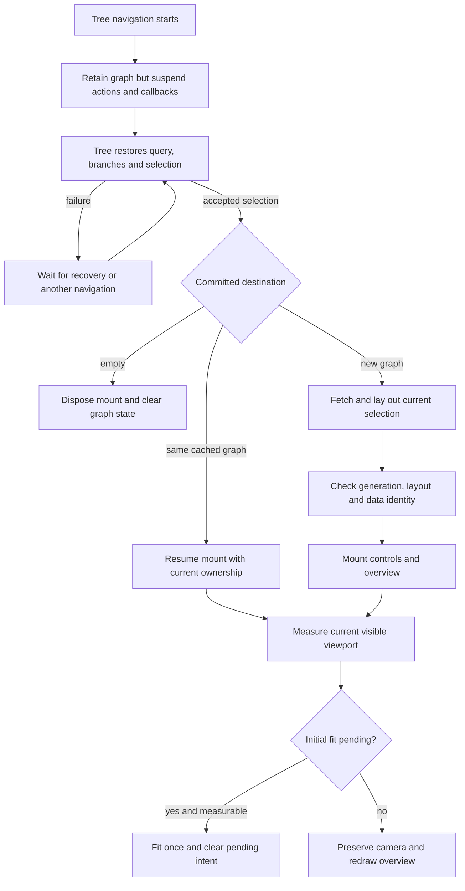

# fa-7: Integrate Accessible Graph Controls with Explorer History - Plan

## Goal Capsule

- **Objective:** Explorer users can operate the graph by keyboard and understand its overview after navigating Back and Forward.
- **Means:** Restore the complete PR #49 range and integrate its graph lifecycle with current-main history ownership (KTD1-KTD4).
- **Authority:** The supplied mandate identifies chief-repository `docs/plans/2026-10-26-0705-feat-codex-drawdown-campaign-plan.md`, limited to its Goal Capsule and Campaign R11, R15, R16, R17, R19, R20, followed by applicable repository instructions and this item's contract.
- **Authority limitation:** The chief repository and `ops/drawdown/mandates/_common.md` were unavailable and were not read. The controller must compare those relevant sections before build dispatch; this document does not claim that comparison occurred.
- **Execution:** One expansion, one branch, one replacement PR. This stage commits only the plan. The subsequent build runs `lfg` on it, including implementation, simplification, review, verification where supported, and local commits; the controller finishes publication under R8.
- **Stop conditions:** A missing source commit or unresolved authority conflict stops dependent build work. Missing verification prevents claiming completion. Missing source is reported under `## Needs your decision` as the mandate directs; host and authority access are controller prerequisites, not credential requests.

---

## Product Contract

### Summary

Bring PR #49's accessible graph controls, synchronized minimap, layout fixes, and regression coverage onto the supplied baseline. Preserve Explorer history behavior and the unrelated MCP telemetry changes already present.

### Problem Frame

PR #49 was built before #48's history changes and now conflicts with main. Both versions manage asynchronous graph work, but their ownership checks differ: a textual merge can leave old controls active during navigation or permanently disable callbacks after cached selection reuse.

### Key Decisions

- **Expand behind existing guardrails.** Governs R7, R8. (session-settled: user-directed — chosen over holding expansions for personal review: assigned expansion work proceeds through established review and verification gates.)
- **Use the selected execution models.** Governs R8. (session-settled: user-directed — chosen over a Sol-first local ladder: local work uses Astra; cloud builds retain default Sol with Astra/Fable reviews.)
- **Keep the assigned work bounded.** Governs R9. (session-settled: user-directed — chosen over speculative features: durable hygiene follows exhausted worthwhile work, rather than inventing another expansion.) The historical no-user-time direction through 2026-10-30 does not reopen these decisions.

### Requirements

**History and graph behavior**

- R1. Preserve #48's Back/Forward restoration of query, independent expansions, occurrence, selection, details, ontology, and empty states, together with its stale-work protections.
- R2. Preserve #49's native keyboard pan, zoom, Fit, accessible announcements, focus behavior, fullscreen operation, and synchronized minimap, including its original tests.
- R3. While navigation is pending, obsolete graph controls and callbacks must not change the camera, overview, DOM, or focus; accepted same-selection and different-selection destinations must become operable.
- R4. A hidden initial graph must fit when first measurable, while subsequent tab returns, cached reselection, resize, and fullscreen transitions preserve completed user zoom and expansion.
- R5. Camera actions create no history entries, and graph-node selection retains its existing single-entry behavior.
- R6. Empty and Canon destinations expose no orphan graph UI and start no graph requests.

**Delivery and evidence**

- R7. Retain all existing tests and both browser harnesses, add cross-feature regressions, pass the full suite, and commit fresh styled screenshots for affected pages (Campaign R15/R16).
- R8. Commit locally without adding a remote or seeking credentials; the controller owns scanning, pushing, the replacement PR, and required campaign review/merge gates (Campaign R11/R15/R19). The final build handoff must say the new PR supersedes #49 and #24.
- R9. Work only `fa-7` on `drawdown/fa-7`, leaving production hosts/configuration untouched and public artifacts free of secrets, private data, or machine-local paths (Campaign R11/R17). No migration, data rewrite, package release, or new service is expected; a genuinely necessary exception follows the campaign's `## Held change` rule.
- R10. Restore the entire source range and preserve current-main changes from #48 and #50, delivering an actual source/test delta rather than a plan or receipt alone.

### Acceptance Examples

| ID | Covers | Given / When / Then |
|---|---|---|
| AE1 | R1, R2, R5 | Given class or property history with independent branches, Back/Forward restores the view; keyboard controls operate on that graph, update its overview, and leave history length unchanged. |
| AE2 | R3, R4 | Given a held restore and retained old mount, buttons, wheel, resize, and queued observer work cannot change it; after same-selection acceptance, controls and observation resume without refitting completed zoom. |
| AE3 | R1, R3, R6 | Given delayed fetch, children, ELK, or mount work, navigating to another or empty selection prevents stale nodes, controls, overview, and focus from returning. |
| AE4 | R2, R4 | Given an initially hidden render, its first reveal fits once; keyboard zoom followed by hide/reveal, resize, or fullscreen preserves camera and expansion while updating the overview. |
| AE5 | R2, R3 | Given repeated keyboard expansion followed by navigation or a deliberate focus move, only current eligible expansion may restore focus; fullscreen trapping, Escape return, and clipped-child Tab exclusion remain correct. |
| AE6 | R1, R6 | Given Canon selection and Back/Forward, details retain full width with no graph UI or graph requests; returning to FOLIO restores normal graph operation. |

### Scope Boundaries

Retain the existing jQuery, vanilla JavaScript, Jinja2, and vendored ELK stack. Per-history camera persistence, an interactive minimap, global keyboard shortcuts, a replacement renderer/test framework, and production drift repair are outside this integration. Existing behavior and tests settle the design; those additions would require separately assigned work.

### Sources

- Current `folio_api/static/js/unified_tree.js`: `beginNavigation`, `restoreHistory`, `notifySelection`, and `writeView`.
- Current and source `folio_api/static/js/entity_graph.js`: selection, generation checks, rendering, fit, mount resources, controls, and focus.
- `docs/plans/2026-11-11-0153-feat-fa-5-land-history-plan.md` and source `docs/plans/2026-11-11-0302-feat-fa-6-graph-controls-landing-plan.md`: prior integration contracts, with their receipts treated as historical evidence.
- `tests/browser/README.md`, `tests/browser/graph_history_browser.py`, and source `browser_tests/README.md`: separate browser seams and execution requirements.
- `docs/solutions/developer-experience/2026-09-19-codex-worker-sandbox-cannot-run-pytest-or-app.md`, qualified by current isolated test harnesses: real host verification, without socket or event-loop workarounds.

---

## Planning Contract

### Verified Starting State

The supplied branch `drawdown/fa-7` was clean at `d91a8cbc3384c5c5952ba3668b71d6817607b85d`, containing #48 and #50. Source commit `f6fa3f7eed87d71b44436b8a2d80b6698cc68781` exists locally; its common base with the supplied baseline is `53a615e9af07f2b6b67d13d99808ead8caa69212`.

Local `main` is `36a0e97a61b5115e167829ee44cce4096c7e887c`, an ancestor 40 commits behind the supplied baseline. Preserve the supplied branch rather than resetting to the stale ref. The controller verifies canonical-main freshness and clean application before publication.

No remote or repository/ancestor `AGENTS.md` or `CLAUDE.md` was found in the exposed workspace. Repository configuration supplies no docs-root or output override, so this plan uses Markdown under `docs/plans/`. Its `cross_model_review_mode: off` does not waive campaign review requirements.

The source range contains all nine commits, in order:

| Commit | Source intent |
|---|---|
| `3594c42` | fa-6 landing and regression plan |
| `a8961aa` | Accessible controls and minimap plan |
| `ffe356d` | Controls and synchronized overview implementation |
| `214047e` | Saved intermediate work |
| `78067ed` | Review fixes |
| `fb35e82` | Browser verification documentation |
| `6767765` | Keyboard/minimap tests and isolated browser CI |
| `d2d5293` | Further review fixes |
| `f6fa3f7` | fa-6 verification and review resolution |

Anticipated overlap includes `folio_api/static/js/entity_graph.js`, `pyproject.toml`, and `uv.lock`. CSS/template changes must be inspected together with the JavaScript; `.planning/STATE.md` and historical evidence also arrive in the complete range. These are anticipated integration areas, not conflicts observed through an attempted cherry-pick.

### Assumptions

- AS1. The controller-supplied baseline is the intended current-main snapshot for this lane. Canonical-main freshness cannot be established from the stale local ref without controller reconciliation.
- AS2. The two existing browser harnesses remain separate because each proves a different boundary; integrating their invocation into the incoming graph workflow is sufficient for this item.
- AS3. The supplied passive minimap and native controls are the intended design. This item adds no per-history camera snapshot contract.

### Key Technical Decisions

- KTD1. **Restore the complete range on the supplied branch.** For R10, use the mandate's merge-base-to-source cherry-pick after confirming the source object and baseline ancestry. Resolve individual hunks against current-main behavior and source intent; avoid whole-file ours/theirs resolution. Intermediate saved work must reach the source range's final state, including its recorded cleanup.
- KTD2. **Keep history authority in #48.** For R1, R3, R5, R6, `unified_tree.js` remains the history owner, and `entity_graph.js` retains graph/layout generations, committed selection, null clearing, and `renderedData` identity checks through final paint. Camera actions never call the history writer.
- KTD3. **Suspend and deliberately resume the retained mount.** For R3, navigation-start cancels render/mount frames and drag/pan, clears pending focus, and makes viewport actions and observer work inert. Preserve reusable mount resources and identity; accepted same-selection reuse explicitly refreshes current ownership, enabled controls, and measurement scheduling. Queued callbacks validate navigation, mount, graph/layout, and data ownership before touching DOM or focus, without permanently relying on epochs captured before navigation.
- KTD4. **Unify fit and disposal semantics.** For R2-R4, `initialFitPending` owns initial-fit intent and `mount.needsFit` mirrors it for the current mount; a successful measurable fit clears both. Preserve the current generation check inside `fitGraph` while adopting source live geometry and disposal. Keep resource cleanup on replacement/empty/error/skeleton paths, cancelable frames, common `applyTransform` updates, and focus-version checks. User Fit remains separate from automatic pending-fit resumption.
- KTD5. **Keep distinct test environments and compatible dependencies.** For R7/R10 and AS2, retain `playwright>=1.55,<2` and add `pytest-playwright>=0.10.0`, keeping Python `>=3.13,<4.0.0`, `folio-mcp[kaos]>=0.4.6`, and current production pins. Resolve the test lock deliberately: baseline Playwright is 1.64.1 and incoming is 1.65.0. Run history discovery explicitly in the incoming graph workflow without changing API workflow semantics.
- KTD6. **Give new evidence separate names.** For R7, add `--fa7-evidence-dir` with a navigation-aware capture test to the graph harness and `FOLIO_BROWSER_EVIDENCE_PREFIX`, defaulting to `fa-5`, to the history capture helper. Preserve existing options, defaults, assertions, and historical fa-2/fa-5/fa-6 artifacts.

### Lifecycle Design

The tree owns navigation and accepted selection. The graph combines #48's asynchronous ownership with #49's mount-resource lifecycle:



Focus restoration follows the same validity boundary plus source focus eligibility checks. Fullscreen reparents the existing pane; observers update geometry without rebuilding state or refitting completed user zoom.

### Dependencies and Execution Uncertainties

U1 precedes U2; U3 tests the integrated lifecycle, and U4 verifies the resulting source revision. Controller authority comparison precedes build dispatch. Supported host execution and canonical-main comparison precede publication.

No product decision is unresolved. Runtime ordering, cached-mount resumption, dependency resolution, and fullscreen geometry remain build-stage checks. No tests, dependency installation, application start, cherry-pick, or screenshot capture ran during planning; historical receipts do not verify fa-7.

---

## Implementation Units

### U1. Restore the complete source range and reconcile dependencies

**Goal:** Establish the full replacement change while preserving the supplied baseline.

**Requirements:** R8-R10; KTD1/KTD5; AS1.

**Dependencies:** Recheck branch/source availability and the controller's authority comparison.

**Files:** All source-range files, especially `pyproject.toml`, `uv.lock`, `.github/workflows/graph-browser-tests.yml`, `browser_tests/app.py`, `browser_tests/conftest.py`, `browser_tests/entity_graph_controls.py`, `browser_tests/test_entity_graph_accessibility.py`, and `.planning/STATE.md`.

**Approach:** Apply KTD1's complete range. Preserve current history and telemetry changes while reconciling browser dependencies. Inspect imported state and documentation for stale claims, retaining historical artifacts as provenance. Do not leave intermediate recovery files that the supplied range itself removes.

**Patterns:** Current manifests/API workflow and incoming isolated browser launcher.

**Test scenarios:**

1. All nine commits' intended final changes arrive, including graph source and both incoming test modules.
2. #48 history files and #50 telemetry remain present; the combined dependency group supports both browser interfaces.
3. Existing API, application-start, Canon, and telemetry tests remain unchanged and pass in the final full-suite run.

**Verification:** Inspect the actual source/test diff against the supplied baseline, check lock consistency, and record real conflicts/resolutions. Behavioral proof follows U2-U4.

### U2. Compose history, controls, fit, and mount ownership

**Goal:** Make controls and minimap follow the accepted history destination.

**Requirements:** R1-R6; KTD2-KTD4; AE1-AE6.

**Dependencies:** U1.

**Files:** `folio_api/static/js/entity_graph.js`, `folio_api/static/css/styles.css`, `folio_api/templates/jinja2/explore/tree.html`, and `tests/browser/graph_history_browser.py`. Inspect `folio_api/static/js/unified_tree.js` as the unchanged history-owner reference.

**Approach:** Integrate navigation-start, accepted selection, cached refresh, final render, observer scheduling, and disposal under KTD2-KTD4. Gate native controls, wheel, and public Fit consistently. Carry flex/scroll/clipping CSS and fullscreen template changes together, retaining hidden-state behavior and Canon's conditional graph absence.

**Execution note:** Add focused failing regressions for the interaction being repaired before changing the merged lifecycle; retain the original assertions.

**Patterns:** Current graph/layout generation checks and held-work browser fixtures; incoming mount identity/disposal and keyboard focus rules.

**Test scenarios:**

1. Covers AE2. Hold navigation while old graph DOM remains, try keyboard controls and wheel, and release scheduled observer/frame work; no old camera or focus mutation occurs, and same-selection acceptance resumes usable controls.
2. Covers AE3. Accept a different or empty destination before delayed fetch/children/ELK/mount callbacks finish; old controls, overview, nodes, and focus cannot return.
3. Covers AE4. Reveal a graph whose first fit was deferred, then zoom by keyboard and cycle tabs/fullscreen/resize; initial fitting completes once and subsequent camera/expansion are retained.
4. Covers AE5. Navigate or deliberately move focus during repeated expansion; stale remounts never reclaim focus, while current same-graph expansion retains its tested focus behavior.

**Verification:** Syntax checks plus U3's real-browser assertions pass. This fixture seam proves frontend state ownership, not production service behavior.

### U3. Add integration regressions and make CI run both harnesses

**Goal:** Prove the interactions that the original suites test separately.

**Requirements:** R1-R7; KTD5; AE1-AE6.

**Dependencies:** U2.

**Files:** `tests/browser/graph_history_browser.py`, `tests/browser/tree_history_browser.py`, `tests/browser/ontology_history_browser.py`, `tests/browser/support.py`, `browser_tests/entity_graph_controls.py`, `browser_tests/test_entity_graph_accessibility.py`, `.github/workflows/graph-browser-tests.yml`, `tests/browser/README.md`, and `browser_tests/README.md`.

**Approach:** Reuse hold/release barriers and real ELK scheduling instead of sleeps. Add the history command to graph CI, retaining explicit incoming pytest paths, no-skip JUnit validation, bounded server readiness, shutdown checks, and artifact upload. Keep API CI's coverage and failure semantics intact.

**Patterns:** Existing routed history fixtures and separate real-app graph fixtures; `scripts/check_pytest_results.py`.

**Test scenarios:**

1. Covers AE1. For both classes and properties, assert query, independently expanded branches, occurrence, selection, and details after Back and Forward; operate native controls, check current summary/rendered minimap, and assert unchanged history length for camera actions.
2. Covers AE2/AE3. Verify same-selection and different-selection recovery after pending/failed restoration, plus empty-state disposal and existing stale-work cases with added overview/resource/focus assertions.
3. Covers AE4/AE5. Retain Enter/Space, zoom limits, live geometry, DPR, pixel-derived minimap projection, absent-canvas fallback, clipped focus, fullscreen trap, Escape return, and hidden-first-fit tests.
4. Covers AE6. Preserve full Canon identifiers and document history; the shared CSS leaves full-width details, with no graph controls or graph requests.
5. Both harnesses execute explicitly in the incoming workflow; missing prerequisites or omitted/empty/skipped graph results cannot produce a successful check.

**Verification:** All 65 original history unittest methods and all incoming graph tests remain, with new integration assertions passing. The isolated graph server proves actual application/template integration beyond the routed history harness.

### U4. Capture styled evidence and prepare the controller handoff

**Goal:** Deliver reviewable proof for the integrated revision.

**Requirements:** R7-R10; KTD6.

**Dependencies:** U3.

**Files:** `tests/browser/support.py`, `browser_tests/conftest.py`, `browser_tests/test_entity_graph_accessibility.py`, both browser READMEs, fa-7 images listed below, and `docs/plans/evidence/fa-7-verification.md`.

**Approach:** Capture graph states after actual Back/Forward navigation with expanded nodes and visible keyboard focus. Capture tree Back/Forward and Canon details because shared CSS/template changes affect them. Keep ordinary test runs from writing tracked evidence unless capture is requested.

**Test scenarios:**

1. Embedded, fullscreen, and narrow graph captures follow successful integrated navigation assertions and show current controls/minimap.
2. Tree captures show the restored destination in each direction; Canon retains its full-width details view.
3. fa-7 capture writes only the new evidence paths and leaves historical images untouched.

**Verification:** Execute the host contract, inspect every image, and record tested commit, commands, counts, fixture scope, limitations, and paths. Controller publication remains subject to required campaign reviews.

---

## Verification Contract

### Execution Boundary

Unix sockets and browser startup are restricted in the lane. Do not launch or retry Chromium there, patch sockets/logging/selectors, or substitute static checks for behavioral verification. Host commands below remain pending until run in a supported environment; close every opened browser, context, page, and fixture server.

### Build and Static Checks

After confirming branch ancestry and source availability, U1 uses the mandate's restore command:

```bash
git cherry-pick $(git merge-base HEAD f6fa3f7eed87d71b44436b8a2d80b6698cc68781)..f6fa3f7eed87d71b44436b8a2d80b6698cc68781
```

After deliberate manifest/lock reconciliation, check the lock with `uv lock --check`, whitespace with `git diff --check`, graph syntax with `node --check folio_api/static/js/entity_graph.js`, and Python syntax with `python -m compileall -q tests/browser browser_tests`. Check any other changed JavaScript with `node --check`. These checks do not prove browser behavior.

### Supported Host Commands

Install locked dependencies and Chromium:

```bash
uv sync --locked --dev --group browser --python 3.13
uv run --no-sync playwright install chromium
mkdir -p test-results
```

Run the complete API suite with coverage and its existing no-skip checker:

```bash
uv run --no-sync pytest tests -ra --output=test-results/api-playwright --junitxml=test-results/pytest.xml
uv run --no-sync python scripts/check_pytest_results.py test-results/pytest.xml
```

Prepare the history harness's existing presentation dependency in a noncommitted location, verify its documented hash, and run styled history verification with the planned prefix option:

```bash
curl --fail --location --max-time 45 'https://cdn.tailwindcss.com/3.4.17?plugins=forms,typography,aspect-ratio' --output test-results/tailwind-3.4.17.js
printf '%s\n' 'afcd5f979c919a39cdfafefe983bde4f5bd41caab98cb2eb0efd2cf56b8d1355  test-results/tailwind-3.4.17.js' | sha256sum --check
FOLIO_BROWSER_TAILWIND=test-results/tailwind-3.4.17.js FOLIO_BROWSER_SCREENSHOTS=1 FOLIO_BROWSER_EVIDENCE_PREFIX=fa-7 uv run --no-sync python -m unittest discover -s tests/browser -p '*_browser.py' -v
```

Run `uv run --no-sync python -m browser_tests.app` in a managed host terminal, directing its output to `test-results/graph-server.log`. Require successful `curl --fail --silent --max-time 2 http://127.0.0.1:9616/info/health`, with the incoming workflow's bounded 90-attempt readiness check and early process-exit detection. Then run:

```bash
uv run --no-sync pytest -o addopts='' browser_tests/entity_graph_controls.py browser_tests/test_entity_graph_accessibility.py --browser chromium --base-url http://127.0.0.1:9616 --output=test-results/playwright --junitxml=test-results/graph-browser.xml --fa7-evidence-dir docs/plans/evidence
uv run --no-sync python scripts/check_pytest_results.py test-results/graph-browser.xml
```

Terminate that fixture server with SIGTERM, await its exit, and require successful isolation/shutdown checks and a nonempty server log. Preserve the incoming workflow's cleanup trap on failure. Keep Playwright output directories separate from JUnit reports and server logs because Playwright clears its output directory.

### Evidence and Gates

| Check | Required evidence |
|---|---|
| API suite | Successful complete run, normal coverage, accepted nonempty JUnit with no skipped/failed/errored cases. |
| History suite | All 65 original methods plus additions pass: graph 12, ontology 7, tree 25, recovery 21 before additions. |
| Graph suite | Both modules explicitly collected; retain 18 inherited plus 7 additional source test functions. Historical 56 parametrized cases are a reference, not a claimed current count. Record actual collection and results. |
| Integration | AE1-AE6 pass with real DOM, transforms, ELK, and rendered overview; held-work tests prove stale callbacks lose ownership. |
| Visual review | Fresh styled `docs/plans/evidence/fa-7-graph-controls-embedded.png`, `docs/plans/evidence/fa-7-graph-controls-fullscreen.png`, `docs/plans/evidence/fa-7-graph-controls-narrow.png`, `docs/plans/evidence/fa-7-tree-history-back.png`, `docs/plans/evidence/fa-7-tree-history-forward.png`, `docs/plans/evidence/fa-7-graph-history-refit.png`, and `docs/plans/evidence/fa-7-canon-details.png`. |
| Review/publication | Required simplification, code review, Astra/Fable campaign review where applicable, controller scan, canonical-main clean application, and required checks. Local review configuration does not waive campaign gates. |

The history harness uses synthetic routed ontology data, real templates/scripts, pinned Tailwind, and fallback fonts. The graph harness runs the isolated real application with checked snapshots; graph-specific cases route synthetic graph payloads, while the class/property smoke uses the running ontology. Its normal presentation styling must load. Neither fixture scope proves production reachability or a manual screen-reader pass.

---

## Definition of Done

- U1 restores the complete range under R10, with compatible manifests and a reviewed lock diff.
- U2 satisfies R1-R6, and U3 provides passing AE1-AE6 coverage without deleting or weakening original tests.
- U4 commits the specified fresh images and an honest `docs/plans/evidence/fa-7-verification.md` identifying the tested source revision and any evidence-only follow-up commit.
- All Verification Contract gates pass before build completion; missing host runs or campaign reviews remain explicit controller prerequisites.
- The final diff against the supplied baseline and canonical main contains the PR's source/test changes, with no abandoned experiments or unrelated production/configuration edits. Identify the stale local-main comparison separately.
- The build handoff identifies `fa-7`, expansion, `drawdown/fa-7`, the committed plan path, review/test receipts, every screenshot as `SCREENSHOT: <path>`, and local commit state. It states that the replacement PR supersedes #49 and #24 and that the lane performed no push.
- Any held change or Damien-only blocker follows the campaign's required final heading and details; none is currently expected.
- A plan-only local commit completes the planning stage, not this implementation's Definition of Done.
